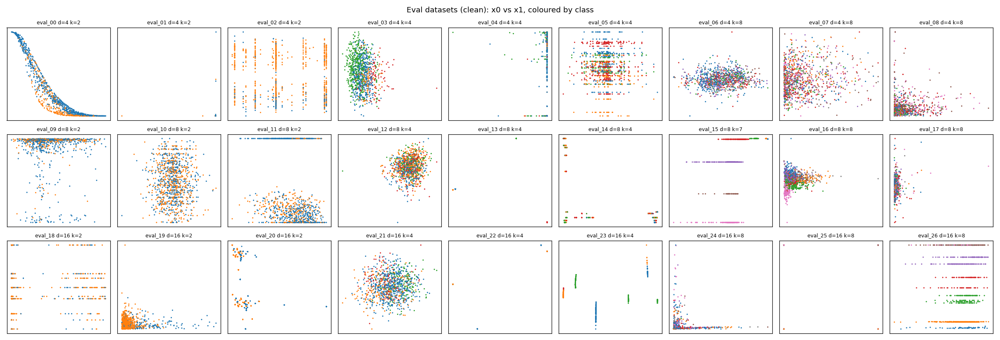
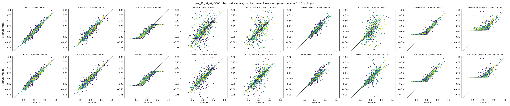
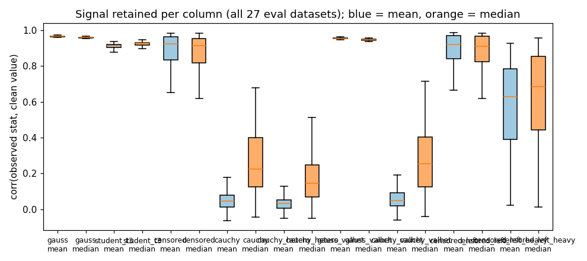
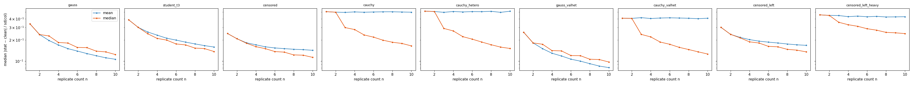
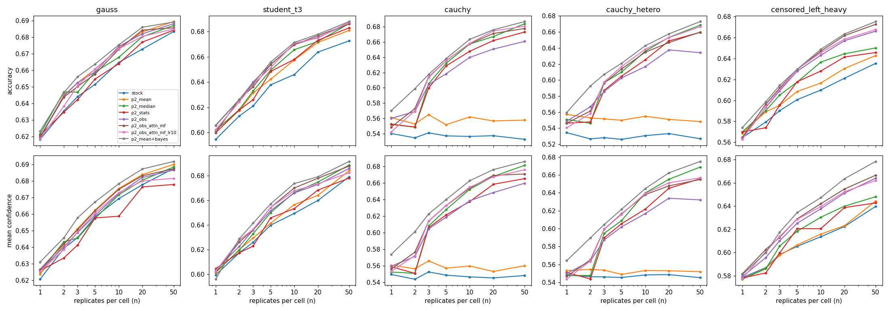

# RESEARCH — observation-model noise vs. TabICLv2

Log of quick experiments supporting [NOTES.md](NOTES.md) (ObsPFN). Code: [experiments/obs_noise/](experiments/obs_noise/).

---

## Exp 1 — How much does replicate noise cost a pretrained TabICL, and do summary statistics or fine-tuning recover it? (2026-10-18)

**Question.** If replicated, noisy measurements are collapsed into one value per cell (as imputation does, `x_mean`)
or into a set of summary columns (`x_mean, x_median, x_sd, x_iqr, x_sem, x_logn`), how much accuracy does
TabICLv2 lose relative to the clean table, and does per-dataset fine-tuning close the gap?
This is the "summary stats" baseline that NOTES.md Stage 1 must beat.

### Setup

| | |
|---|---|
| Model | TabICLv2 classifier, `tabicl==2.2.0`, checkpoint `tabicl-classifier-v2-20260212.ckpt` (HF `jingang/TabICL`), default inference (8 estimators), `random_state=0` |
| Data | 27 datasets from this repo's nanoprior ([prior.py](prior.py)): grid n_features ∈ {4, 8, 16} × n_classes ∈ {2, 4, 8} × 3 seeds; numerical features only; 1024 rows, stratified 512 context / 512 holdout; resampled until every class has ≥16 rows (1 dataset needed 2 attempts; one d8/k8 dataset ended with 7 classes) |
| Observation model | Per cell, independently: replicate count n ~ U{1..10}; replicates = x + 0.5·sd(col)·ε. Noise models (easy → hard): **gauss** ε~N(0,1); **student_t3** ε~t₃; **censored** Gaussian then clipped at the column's clean 10th/90th percentile (reported *at* the limit, no indicator); **cauchy** ε~Cauchy; **cauchy_hetero** Cauchy × per-row scale exp(N(0,1)) (heteroscedastic rows). Labels y stay clean; context *and* holdout X are observed through the same model |
| Feature arms | **clean** (reference); **mean** = `x_mean` only (what mean-imputation gives); **full** = `x_mean, x_median, x_sd, x_iqr, x_sem, x_logn` (sd/iqr/sem = 0 when n=1). 1 + 5 noise × 2 feature = **11 arms** |
| Fine-tuning | `tabicl.FinetunedTabICLClassifier` per dataset, fitted on the 512-row context only (internal 20% stratified val split, early stopping on val log-loss, never worse than pretrained on val). LR/epochs chosen on a disjoint **pilot pool** (64 prior datasets, different seeds), never on eval holdouts |
| Metrics | holdout accuracy, balanced acc, ROC-AUC (OvR macro), log-loss; all comparisons **paired over the 27 datasets**, ± = SE |

**Reproducibility (step 0).** Every dataset is seeded by `(seed, attempt)` for the prior and by
`(SEED_NOISE, seed, noise_model)` for the observation model, independent of process/worker order.
Regenerating everything from scratch reproduced all 654 stored arrays bit-for-bit (also with a different worker count).
TabICL inference with a fixed checkpoint + `random_state=0` is deterministic (re-inference max |Δp| = 0).
GPU fine-tuning is seeded but not guaranteed bitwise-deterministic; the resulting weights are stored instead.

```bash
cd experiments/obs_noise
python gen_data.py                    # env: requirements-data.txt  (~1 min, 16 workers)
python data_report.py                 # figures/datasets*.{csv,png}
python run_tabicl.py --stage pilot --lr 1e-5 --epochs 30     # env: requirements-tabicl.txt; repeat for the grid
python run_tabicl.py --stage eval --modes zeroshot
python run_tabicl.py --stage eval --modes finetuned --lr <chosen> --epochs <chosen>
python analyze.py --stage eval
```

**Stored artifacts** (`experiments/obs_noise/artifacts/`, gitignored):
- `data/eval/<name>.npz`: `X_clean, y, train_idx, test_idx`, and per noise model `<noise>__replicates` (n×d×10, NaN-padded), `<noise>__counts`, `<noise>__full`, `<noise>__mean`. `data/manifest.json` has seeds and class counts. `data/pilot_pool.npz` holds the pilot datasets.
- `runs/eval/results_eval.jsonl`: one record per (dataset, arm, mode) with metrics, timing, the checkpoint used and fine-tuning info.
- `runs/eval/preds/eval__<dataset>__<arm>__<mode>.npz`: holdout probabilities, `test_idx`, `y_test`.
- `runs/eval/ckpts/<dataset>/<arm>.ckpt`: fine-tuned weights (`{config, state_dict}`), written only when fine-tuning actually changed them. Otherwise the record's `ckpt` field is the base checkpoint name.
- Re-infer any prediction with `TabICLClassifier(model_path=ckpt, random_state=0).fit(X_arm[train_idx], y[train_idx]).predict_proba(X_arm[test_idx])`. `X_arm` is `X_clean` or `<noise>__<feats>` from the dataset npz.

### Data

Per-dataset stats: [figures/datasets.csv](experiments/obs_noise/figures/datasets.csv).



The prior gives diverse tables: smooth manifolds, discretized/stair-step columns, near-point-mass columns with rare
outliers (e.g. eval_01, 13, 22, 25), and class balance from 50/50 down to 2% minority classes.





Signal kept per column, as the median corr(observed stat, clean value) across all 27 datasets:

| noise | mean | median |
|---|---|---|
| gauss | 0.96 | 0.96 |
| student_t3 | 0.91 | 0.93 |
| censored | ≈0.92 (wide: 0.65–0.98) | ≈0.91 |
| cauchy | **0.05** | 0.22 |
| cauchy_hetero | **0.03** | 0.15 |

- Under Cauchy noise the mean carries essentially no information, and more replicates don't help it (error-vs-n is flat). The median recovers steadily with n.
- Under Gaussian noise the mean is slightly better than the median, as expected (efficiency).
- **Caveat:** noise scale is 0.5·sd(col). For point-mass-plus-outlier columns, the outliers dominate the sd, so the noise is large relative to the bulk. In eval_01, censoring at the 10th/90th percentile clips ~100% of replicates because q10 ≈ q90.

### Results — zero-shot (steps 2, 6, 8)

Mean over 27 datasets; Δ = arm − clean, paired, ± SE.

| arm | acc | ROC-AUC | log-loss | Δacc | ΔAUC | Δlog-loss |
|---|---|---|---|---|---|---|
| **clean** | **0.742** | **0.848** | **0.635** | | | |
| gauss / mean | 0.673 | 0.789 | 0.780 | −0.069 ± 0.021 | −0.059 ± 0.014 | +0.145 ± 0.045 |
| gauss / full | 0.669 | 0.786 | 0.788 | −0.073 ± 0.021 | −0.061 ± 0.014 | +0.152 ± 0.046 |
| student_t3 / mean | 0.657 | 0.776 | 0.821 | −0.085 ± 0.024 | −0.072 ± 0.016 | +0.186 ± 0.053 |
| student_t3 / full | 0.660 | 0.780 | 0.815 | −0.082 ± 0.023 | −0.067 ± 0.014 | +0.180 ± 0.050 |
| censored / mean | 0.669 | 0.781 | 0.793 | −0.073 ± 0.022 | −0.067 ± 0.018 | +0.158 ± 0.047 |
| censored / full | 0.666 | 0.776 | 0.802 | −0.076 ± 0.023 | −0.071 ± 0.016 | +0.167 ± 0.047 |
| cauchy / mean | 0.581 | 0.699 | 0.987 | −0.161 ± 0.033 | −0.149 ± 0.020 | +0.352 ± 0.072 |
| cauchy / full | 0.628 | 0.749 | 0.885 | −0.114 ± 0.026 | −0.099 ± 0.018 | +0.249 ± 0.061 |
| cauchy_hetero / mean | 0.570 | 0.683 | 1.021 | −0.172 ± 0.032 | −0.165 ± 0.019 | +0.386 ± 0.074 |
| cauchy_hetero / full | 0.617 | 0.735 | 0.920 | −0.125 ± 0.027 | −0.113 ± 0.017 | +0.284 ± 0.061 |

Full summary stats − mean only, paired. "wins" = datasets where full is better:

| noise | Δacc | ΔAUC | Δlog-loss | wins (AUC) |
|---|---|---|---|---|
| gauss | −0.004 ± 0.002 | −0.002 ± 0.002 | +0.008 ± 0.002 | 7/27 |
| student_t3 | +0.003 ± 0.002 | +0.005 ± 0.003 | −0.006 ± 0.004 | 18/27 |
| censored | −0.004 ± 0.002 | −0.004 ± 0.003 | +0.009 ± 0.003 | 6/27 |
| cauchy | **+0.047 ± 0.010** | **+0.050 ± 0.006** | **−0.103 ± 0.023** | 26/27 |
| cauchy_hetero | **+0.047 ± 0.009** | **+0.052 ± 0.005** | **−0.102 ± 0.022** | 26/27 |

**Observations (zero-shot):**
1. **Even mild replicate noise is expensive.** Gaussian noise, where the per-cell mean keeps r ≈ 0.96 with the clean value, costs about 7 points of accuracy and 0.06 AUC. Pretrained TabICL is fragile to measurement noise in X: a column that is 96% correlated with the truth gives far less than 96% of the accuracy. This is the gap ObsPFN targets.
2. **The ladder is not monotone in the middle.** student_t3 (−8.5 pts) is a bit worse than gauss or censored (−7 pts). Censoring hurts little *on average* but has the widest spread: it destroys datasets whose signal sits in the tails or in spiky columns.
3. **Under heavy tails, summary stats help, but only via robust location.** With Cauchy noise, the full arm recovers about 30% of the mean-arm gap (−16 → −11 pts), consistently: AUC improves on 26/27 datasets. The table and figures point to the `median` column as the source; the spread columns can't be informative because the noise doesn't depend on y. A full − mean − median ablation would confirm this.
4. **With light noise, extra columns slightly hurt.** For gauss and censored, 6× the columns is a small but consistent loss (for gauss, full beats mean on AUC in only 7/27 datasets). TabICL gets no use out of sd/iqr/sem/logn as reliability signals; they just dilute. So "beats summary stats" (NOTES.md Stage 1) is a low bar for light noise, where the baseline is effectively `x_mean`. For heavy tails, the bar is the median.
5. **Heteroscedastic rows cost a little extra on top of Cauchy** (−1 pt acc, −0.015 AUC). Zero-shot TabICL has no way to down-weight unreliable rows. This is the motivation for NOTES.md Stage 2.

### Additional observation models (zero-shot TabICL, added during Exp 2)

Four more models were appended to `NOISE_MODELS` in gen_data.py. All 648 earlier arrays were verified bit-identical after regeneration.
- **`gauss_valhet`, `cauchy_valhet`:** value-dependent (one-directional) heteroscedasticity. Scale = 0.5·sd·2·rank(x)/n within the column, so the smallest values are nearly exact and the largest get 2× the base noise (average 1×).
- **`censored_left`:** Gaussian noise with a lower detection limit at the clean 30th percentile. Values below are reported *at* the limit, with no indicator.
- **`censored_left_heavy`:** t₂ noise with the limit at the 60th percentile. Most replicates sit at or below the border, and a few outliers land far above it.

| arm | acc | ROC-AUC | Δacc vs clean | ΔAUC vs clean |
|---|---|---|---|---|
| gauss_valhet / mean | 0.684 | 0.797 | −0.058 ± 0.020 | −0.050 ± 0.013 |
| gauss_valhet / full | 0.679 | 0.800 | −0.063 ± 0.021 | −0.048 ± 0.011 |
| cauchy_valhet / mean | 0.597 | 0.717 | −0.145 ± 0.030 | −0.131 ± 0.019 |
| cauchy_valhet / full | 0.638 | 0.757 | −0.104 ± 0.026 | −0.091 ± 0.015 |
| censored_left / mean | 0.668 | 0.781 | −0.074 ± 0.021 | −0.067 ± 0.015 |
| censored_left / full | 0.662 | 0.775 | −0.080 ± 0.022 | −0.072 ± 0.016 |
| censored_left_heavy / mean | 0.616 | 0.735 | −0.126 ± 0.029 | −0.113 ± 0.018 |
| censored_left_heavy / full | 0.630 | 0.743 | −0.112 ± 0.027 | −0.105 ± 0.018 |

Full − mean, paired (Δacc, ΔAUC, datasets where full is better):

| noise | Δacc | ΔAUC |
|---|---|---|
| gauss_valhet | −0.005 ± 0.003 (7/27) | +0.002 ± 0.006 (9/27) |
| cauchy_valhet | +0.042 ± 0.008 (24/27) | +0.040 ± 0.007 (23/27) |
| censored_left | −0.006 ± 0.002 (7/27) | −0.005 ± 0.002 (5/27) |
| censored_left_heavy | +0.014 ± 0.004 (20/27) | +0.008 ± 0.006 (20/27) |

The same pattern as the original five models:
- Light noise costs 6–7 points whether it's value-dependent or left-censored, and extra summary columns slightly hurt.
- Heavy tails cost 11–15 points, and the summary columns (via the median) recover 1–4 points.
- Value-dependent noise costs *less* than homoscedastic noise of the same average scale (gauss_valhet −5.8 vs gauss −6.9 points). Low-value cells are almost exact.
- Fine-tuning was not run on these arms, since it had no effect on any of the original arms.

### Results — fine-tuned (steps 3, 7, 8)

**Picking hyperparameters (pilot pool, 12 datasets × {clean, gauss/full, cauchy_hetero/full}).** Grid: lr ∈ {1e-5, 1e-4} × epochs ∈ {30, 100}.
- Every setting changed holdout metrics by at most ±0.007 log-loss and ±0.006 AUC.
- lr 1e-4 slightly hurt gauss log-loss (+0.007).
- Early stopping usually ended a run within a few seconds.
- I chose lr 1e-5 with 100 epochs: neutral everywhere, and marginally best on hetero.
- Note that with 512 context rows one epoch is a single optimizer step, so "100 epochs" means at most 100 steps.

**Eval (27 datasets × 11 arms, 297 fine-tunes).**
- Weights actually changed in 177 of 297 runs. In the rest, the "never worse on validation" safety net kept the pretrained weights.
- Median fine-tuning time was 9 s per dataset.
- Full tables are in [figures/results.md](experiments/obs_noise/figures/results.md), the plot in [figures/gap.png](experiments/obs_noise/figures/gap.png).

| arm | Δacc (FT − ZS) | ΔAUC | Δlog-loss | noisy − clean gap, ZS → FT (acc) |
|---|---|---|---|---|
| clean | +0.000 ± 0.001 | −0.000 ± 0.000 | −0.000 ± 0.000 | — |
| gauss / mean | −0.001 ± 0.001 | −0.001 ± 0.001 | +0.001 ± 0.001 | −0.069 → −0.070 |
| gauss / full | +0.001 ± 0.000 | +0.000 ± 0.000 | +0.000 ± 0.000 | −0.073 → −0.073 |
| student_t3 / mean | −0.000 ± 0.001 | −0.000 ± 0.000 | +0.001 ± 0.001 | −0.085 → −0.086 |
| student_t3 / full | −0.000 ± 0.001 | −0.001 ± 0.001 | +0.000 ± 0.001 | −0.082 → −0.083 |
| censored / mean | −0.001 ± 0.001 | −0.001 ± 0.001 | +0.001 ± 0.001 | −0.073 → −0.074 |
| censored / full | +0.000 ± 0.000 | +0.000 ± 0.001 | −0.000 ± 0.001 | −0.076 → −0.077 |
| cauchy / mean | +0.000 ± 0.001 | +0.001 ± 0.001 | −0.002 ± 0.002 | −0.161 → −0.161 |
| cauchy / full | +0.003 ± 0.001 | +0.000 ± 0.000 | −0.003 ± 0.002 | −0.114 → −0.111 |
| cauchy_hetero / mean | +0.001 ± 0.001 | +0.001 ± 0.000 | −0.002 ± 0.001 | −0.172 → −0.171 |
| cauchy_hetero / full | −0.001 ± 0.001 | +0.001 ± 0.001 | −0.003 ± 0.001 | −0.125 → −0.126 |

**Observations (fine-tuning):**
1. **Per-dataset fine-tuning recovers nothing** (step 8). The noise gap is unchanged in every arm: at most 0.3 points of accuracy recovered, i.e. between −3% and +2% of the gap closed. On clean data it is also a no-op, consistent with TabICL already being near its in-context optimum on these prior datasets.
2. **The information isn't there to recover.** With 512 noisy rows, one dataset can't teach the model a new observation model. The only lever that worked was giving it a better *input* (the median inside the `full` arm, +4.7 points under Cauchy). That points to pretraining over observation models (Exp 2), not per-dataset adaptation.
3. Fine-tuning helps log-loss slightly under heavy tails (−0.002 to −0.003, 14–17 of 27 datasets improve). This is calibration, not discrimination.

---

## Exp 2 — Replicate-level cell attention (set encoder) on nanoTabICL (2026-10-18)

**Question.** Can a small set encoder over each cell's replicates (NOTES.md Stage 1), added to a pretrained
nanoTabICL, recover the noise gap? Does it keep exact stock behaviour when n = 1? And does it beat the two
baselines: mean imputation, and summary-stat columns?

### Architecture ([obs_model.py](obs_model.py))

`ObsNanoTabICL(NanoTabICLv2)`, following the NOTES.md spec:
- **Input.** Replicates (B, R, C, K=10) plus a validity mask. The backbone receives one value per cell (the cell mean, as the spec says).
- **Encoder, per cell with n ≥ 2.**
  - Standardize with the training rows' column statistics.
  - φ: MLP(z, z − z̄) → d_s = 32.
  - One pre-LN masked self-attention block over the replicates.
  - Attention pooling: one learned seed query, plus a learned null key/value.
  - Concatenate log n.
- **Grouping.** Cell vectors are grouped at column offsets (0, 1, 3), the same as the backbone.
- **Injection.** A **zero-initialized, bias-free** linear map U adds the result to the backbone's cell token. This needed a 2-line hook in [model.py](model.py) (`extra_emb`, default None = unchanged).
- **Guarantees, verified to 0.0 max |Δ| in `python obs_model.py`:**
  - (i) At step 0 the model equals the stock model.
  - (ii) Cells with n = 1 contribute exactly zero at *any* weights. The encoder only runs on n ≥ 2 cells (gather/scatter), and U has no bias.

  So with one sample everywhere, the model *is* the stock model.
- **Size.** The replicate branch is 16k parameters on a 0.97M backbone.
- **Options added while iterating** (all keep guarantee (ii)):
  - `center`: the per-cell value the backbone sees.
    - `'mean'`: the spec.
    - `'median'`: the per-cell lower median.
    - `'attn'`: a learned location Σ_k softmax(s_k)·x_k, with per-replicate scores s_k from a zero-initialized head on the encoder's replicate states. It starts as the mean, so step 0 equals stock-on-means to 3e-7.
    - For `median` and `attn`, the replicates are standardized with the cell-*median* column statistics.
  - `med_feat`: φ also gets z − median(z) as a robust reference.
  - `use_sab`, `use_null`, `d_s`: ablations of the spec's components.

### Training protocol ([obs_train.py](experiments/obs_noise/obs_train.py))

- **Backbone.** ~1M-parameter nanoTabICLv2: embed 32, col/row/icl blocks = 2/2/6, 4 heads, 32 inducing points, 10 classes. This matches the NOTES.md budget.
- **Bank** ([gen_bank.py](experiments/obs_noise/gen_bank.py)). 2000 blocks × 64 = 128k clean nanoprior classification tables.
  - 1024 rows each; 2–16 numerical features per block; 2–10 classes.
  - Seeds are disjoint from Exp 1's eval and pilot sets.
  - Blocks 0–15 are held out for validation.
- **Batches.** 32 tables. Random 256–1024 rows, random 30–80% context.
- **Observation model.** Sampled on the GPU per table.
  - 25% of tables are clean (n = 1).
  - Otherwise one of the 5 Exp 1 noise models, scale ~ logU(0.1, 1)·sd(col), counts ~ U{1..10} per cell.
  - Censoring limits are random quantiles (0–0.2 / 0.8–1).
- **Optimizer.** AdamW (β = 0.9/0.95, wd 0.01), warmup then cosine to 10%, grad-clip 1, bf16 autocast. CE loss on test rows whose class appears in the context.
- **Phase 1 (stock).** 12k steps on clean tables, lr 1e-3.
- **Phase 2.** Every arm starts from the stock checkpoint with the *same* budget, data and noise stream, lr 3e-4:
  - `p2_clean`: continue on clean data. The fair 1-sample reference.
  - `p2_mean`: backbone on noisy cell means (= imputation).
  - `p2_stats`: backbone on 6 summary columns per feature (mean, median, sd, IQR, SEM, log n), i.e. 6× the columns.
  - `p2_obs*`: the replicate encoder.
- **Evaluation** ([obs_eval.py](experiments/obs_noise/obs_eval.py)). On Exp 1's 27 eval datasets, using the *stored* replicates (scale 0.5, censoring at 10/90%): same splits, one forward pass, no ensembling.

**Reproducibility.**
- Deterministic CUDA kernels (`torch.use_deterministic_algorithms`, `CUBLAS_WORKSPACE_CONFIG`).
- The complete bank is required (the block count is asserted).
- Checkpoints carry the numpy and torch RNG states, so a crash-and-resume continues the exact same stream.
- **Verified:** two identical 150-step runs give bit-identical weights, for both the stock and obs models. A run that crashed at step 100 and resumed is also bit-identical to the uninterrupted run.
- The final stock checkpoint `artifacts/pretrain/stock/last.ckpt` came from one uninterrupted run. Its weights sha256 is `e99ed0213349caf02d686dfdf87edd4bbc5d0475eaff6c0eff9dd89659a916f6`.
- Determinism holds on this GPU/driver/library stack (RTX 5070 Ti, torch 2.10+cu128); other hardware may differ.
- `torch.nanmedian` has no deterministic CUDA kernel, so median/IQR use a sort-based quantile that matches numpy's (|Δ| ≤ 3e-14).
- An earlier *preliminary* stock run, trained while the bank was still being generated and restarted once, is kept as `stock_prelim`. It was used **only for architecture exploration** below.

```bash
cd experiments/obs_noise
python gen_bank.py                                      # ~30 min on 14 cores
./supervise.sh stock --mode clean --steps 12000 --batch_size 32 --micro_batch 16 --lr 1e-3 --val_every 1000
./phase2.sh p2_clean p2_mean p2_stats p2_obs ...        # STEPS=4000 by default; supervise.sh = auto exact-resume
python obs_eval.py stock=artifacts/pretrain/stock/last.ckpt p2_obs=artifacts/pretrain/p2_obs/last.ckpt ...
```

### Exploration (from `stock_prelim`, 3000 steps, original 5-model noise mixture)

Used only to choose architectures; the final comparison below is re-run from the reproducible stock checkpoint.
Evaluated on the 27 Exp 1 datasets. The 4 new observation models (below) were **unseen** in this training, so their
columns measure generalization. Accuracy, paired Δ vs `x_p2_stats` (± SE, datasets better of 27):

| model | clean | gauss | t3 | cens | cauchy | c_het | g_valhet* | c_valhet* | cens_L* | cens_L_hvy* |
|---|---|---|---|---|---|---|---|---|---|---|
| stock_prelim (no phase 2) | +0.009±0.003 | −0.004±0.004 | −0.009±0.003 | −0.002±0.002 | −0.075±0.016 | −0.069±0.015 | +0.002±0.004 | −0.072±0.015 | −0.001±0.003 | −0.009±0.005 |
| x_p2_mean | +0.005±0.004 | +0.000±0.004 | −0.004±0.002 | +0.003±0.002 | −0.052±0.011 | −0.048±0.011 | +0.007±0.004 | −0.048±0.011 | +0.005±0.004 | −0.006±0.004 |
| **x_p2_stats** (abs.) | 0.700 | 0.654 | 0.643 | 0.649 | 0.613 | 0.600 | 0.652 | 0.615 | 0.643 | 0.605 |
| x_p2_obs (spec, mean-centered) | +0.005±0.003 | +0.006±0.003 | +0.005±0.003 | +0.006±0.003 | −0.009±0.004 | −0.012±0.004 | +0.007±0.003 | −0.006±0.005 | +0.006±0.003 | +0.009±0.004 |
| x_p2_obs_med (median-centered) | +0.006±0.003 | +0.002±0.003 | +0.005±0.003 | −0.003±0.002 | +0.007±0.004 | +0.001±0.002 | +0.004±0.003 | +0.001±0.003 | +0.001±0.004 | +0.005±0.003 |

\* not in the training mixture for these runs.

**What exploration showed:**
- **Training on noise helps everyone a bit, but means can't fix heavy tails.** `x_p2_mean` gains 2–3 points on Cauchy over stock but stays 5 points behind summary stats. The information is not in the mean.
- **The spec encoder (mean-centered) wins on light noise and loses on Cauchy.**
  - It beats summary stats by 0.5–0.9 points on gauss, t3, censoring and all three light *unseen* models, including `censored_left_heavy` (+0.9, AUC +0.010, 21/27).
  - It trails stats by about 1 point on Cauchy.
  - Diagnosis: the backbone still embeds the garbage cell mean, which the added encoder vector has to cancel. Also, replicates are standardized with cell-mean statistics, and heavy tails inflate the column sd, squashing every z toward 0.
- **The median-centered encoder fixes Cauchy but gives back the light-noise edge.**
  - Feeding the backbone the per-cell median, and standardizing with median-column statistics, makes it ≥ stats on Cauchy (+0.7 acc, AUC +0.008, 18/27) and ties elsewhere.
  - At *step 0* (encoder still a no-op) this variant already matches what the spec encoder reached after 3000 steps. Most of the heavy-tail gain is the robust center itself.
- **Summary stats are a strong baseline under heavy tails**, mostly via the median column. They cost 6× the columns: 1.3× the training-step time and 1.4× the memory of the SAB encoder, 4.7× stock (see the cost table below). They also slightly hurt clean accuracy (−0.6 to −0.9 vs the other arms).
- Every encoder variant keeps n = 1 behaviour exact by construction. On clean data its accuracy is within noise of `x_p2_mean` (0.705–0.707).

### Final comparison (from the reproducible `stock`, 4000 steps, 9-model noise mixture)

All arms start from the same stock checkpoint and see the same data/noise stream. They are evaluated on the 27 Exp 1
datasets, using the stored replicates (scale 0.5, the 9 observation models).
- Full tables (accuracy, ROC-AUC, log-loss; absolute values and paired Δ): [figures/pretrain_results.md](experiments/obs_noise/figures/pretrain_results.md).
- Raw per-dataset records: `artifacts/pretrain_eval_final.jsonl`.

Accuracy, mean over 27 datasets (best noisy-setting value in bold):

| model | clean | gauss | t3 | cens | cauchy | c_het | g_valhet | c_valhet | cens_L | cens_L_hvy |
|---|---|---|---|---|---|---|---|---|---|---|
| stock (no phase 2) | 0.703 | 0.652 | 0.630 | 0.644 | 0.531 | 0.534 | 0.648 | 0.550 | 0.642 | 0.592 |
| p2_clean (clean only) | 0.709 | 0.649 | 0.633 | 0.642 | 0.539 | 0.537 | 0.650 | 0.560 | 0.640 | 0.597 |
| p2_mean (imputation) | 0.701 | 0.656 | 0.638 | 0.648 | 0.560 | 0.551 | 0.657 | 0.574 | 0.647 | 0.600 |
| p2_stats (6 summary cols) | 0.701 | 0.653 | 0.644 | 0.648 | 0.612 | 0.599 | 0.650 | 0.620 | 0.646 | 0.614 |
| p2_obs (NOTES.md spec) | 0.703 | 0.656 | 0.647 | 0.648 | 0.610 | 0.590 | 0.658 | 0.618 | 0.646 | 0.619 |
| p2_obs_med | 0.697 | 0.656 | 0.648 | 0.646 | 0.617 | 0.597 | **0.660** | 0.624 | **0.648** | 0.619 |
| p2_obs_med_mf | 0.704 | 0.656 | 0.647 | **0.651** | 0.618 | 0.599 | 0.656 | 0.629 | 0.644 | 0.622 |
| p2_obs_attn | 0.704 | **0.657** | 0.646 | 0.649 | 0.621 | 0.598 | 0.657 | 0.629 | 0.646 | 0.623 |
| **p2_obs_attn_mf** | 0.703 | **0.657** | 0.646 | 0.649 | **0.626** | 0.598 | 0.657 | 0.629 | 0.646 | 0.622 |
| p2_obs_attn_mf_nosab | 0.702 | 0.655 | 0.646 | 0.650 | 0.615 | 0.596 | 0.658 | 0.621 | 0.646 | 0.619 |
| p2_obs_attn_mf_lr10 | 0.702 | 0.656 | **0.649** | 0.649 | **0.626** | **0.600** | **0.660** | **0.632** | 0.645 | **0.624** |

Paired Δ vs `p2_stats` for the main arms. Each cell is accuracy (points) / log-loss, ± SE; in parentheses, datasets where the model is better, of 27:

| model | gauss | t3 | cauchy | c_het | g_valhet | c_valhet | cens_L_hvy | clean |
|---|---|---|---|---|---|---|---|---|
| p2_mean | +0.4 / −0.005 | −0.5 / +0.012 | −5.1±1.2 / +0.123 (2) | −4.8 / +0.120 | +0.6 / −0.005 | −4.6 / +0.112 | −1.4 / +0.023 | +0.0 / +0.002 |
| p2_obs (spec) | +0.3 / −0.009 | +0.4 / −0.004 | −0.2 / +0.011 | −0.9±0.4 / +0.018 | +0.8 / −0.008 | −0.3 / +0.010 | +0.5 / −0.010 | +0.2 / −0.003 |
| p2_obs_med | +0.3 / −0.004 | +0.4 / −0.006 | +0.5 / −0.009 | −0.2 / +0.002 | +1.0 / −0.010 | +0.4 / −0.002 | +0.6 / −0.013 | −0.5 / +0.005 |
| **p2_obs_attn_mf** | +0.5 / −0.008 | +0.3 / −0.010 | **+1.5±0.4 / −0.021±0.007 (21)** | −0.1 / −0.005 | +0.7 / −0.009 | +0.9 / −0.018 (22) | +0.8 / −0.019 (22) | +0.2 / −0.006 |
| p2_obs_attn_mf_lr10 | +0.3 / −0.007 | +0.5 / −0.009 | +1.4±0.3 / −0.022 (20) | +0.1 / −0.005 | +1.0 / −0.010 | +1.1 / −0.022 (22) | +1.0 / −0.021 | +0.1 / −0.001 |

**1-sample check (clean data, n = 1 everywhere).** The encoder is the stock backbone by construction, so differences on
clean data come only from continued backbone training.

| | acc | ROC-AUC | log-loss |
|---|---|---|---|
| stock | 0.703 | 0.816 | 0.729 |
| p2_clean (4000 more clean-only steps) | 0.709 | 0.819 | 0.715 |
| p2_obs_attn_mf | 0.703 | 0.818 | 0.723 |
| p2_stats / p2_mean | 0.701 / 0.701 | 0.817 / 0.817 | 0.729 / 0.731 |

- `p2_obs_attn_mf` vs stock on clean: +0.000 acc, +0.002 AUC, −0.006 log-loss.
- Vs `p2_clean`: −0.6 ± 0.4 points accuracy and −0.001 AUC. That is the same small cost every noise-trained arm pays, because only 25% of their phase-2 tables are clean.
- **One-sample behaviour = stock nanoTabICL. ✔**

**Cost** ([bench_cost.py](experiments/obs_noise/bench_cost.py); RTX 5070 Ti; bf16; 16 features; GPU otherwise idle):

| architecture | train ms/step (8 tables × 1024 rows) | train peak GiB | inference ms / table (1024 rows) | inference peak GiB |
|---|---|---|---|---|
| stock / mean (C tokens) | 41 | 1.57 | 6.2 | 0.06 |
| summary stats (6C tokens) | 194 | 8.39 | 12.2 | 0.48 |
| encoder, spec (mean, SAB) | 145 | 6.09 | 9.9 | 0.13 |
| **encoder, attn + med_feat (SAB)** | 146 | 6.16 | 10.4 | 0.13 |
| encoder, attn + med_feat, no SAB | 92 | 5.10 | 8.4 | 0.10 |

### Summary — what worked

1. **Learned attention-weighted location (`center='attn'`), plus SAB, plus a median reference feature (`p2_obs_attn_mf`).** This is the best arm overall.
   - It beats summary stats on 7 of 9 noisy settings in accuracy (the other two are ties: −0.1 and −0.0 points) and on all 10 settings (clean included) in log-loss.
   - Its clearest gains are on heavy tails: Cauchy +1.5 ± 0.4 points (21/27), `censored_left_heavy` +0.8 (22/27 on log-loss), `cauchy_valhet` +0.9.
   - It ties on row-heteroscedastic Cauchy and left-censoring.
   - It closes about 55% of stock's Cauchy gap: 0.531 → 0.626, against a clean ceiling of 0.703.
   - It needs only the 16k-parameter branch on the 1M backbone, keeps C tokens, and costs 0.75× the training time, 0.73× the memory and 0.85× the inference time of summary stats.
   - With lr 10× on the branch (`_lr10`) results are equal within noise, marginally better on value-dependent noise.
2. **The zero-init + bias-free injection + gating design from NOTES.md works exactly as intended.** Step 0 equals stock, n = 1 equals stock at any weights (bit-exact), and clean performance is unchanged after training. It also made every variant a safe drop-in: none hurt clean data beyond the shared cost of mixing in noisy training data.
3. **The self-attention block over replicates is worth keeping.** Without it the encoder loses 1.2 ± 0.2 points on Cauchy (better on only 5/27) and learns more slowly, while light noise is unchanged. Replicates need to see each other to identify which one is the outlier.
4. **A robust reference matters under heavy tails.** The median feature adds about +0.6 on Cauchy over `attn` alone. Median-based standardization keeps z informative where mean-based standardization collapses it.
5. **Pretraining over observation models (ObsPFN's premise) is what moves the needle.** TabICL per-dataset fine-tuning recovered nothing (Exp 1). Continued pretraining with noise helped every arm, and the architecture determines how much of the heavy-tail information is usable.

### Summary — what did not work (or not enough)

- **The spec as written (mean-centered backbone input + additive encoder vector)** only ties summary stats. It wins slightly on light noise and loses on Cauchy (−0.2) and row-heteroscedastic Cauchy (−0.9 ± 0.4). The backbone keeps embedding a garbage mean that the additive vector has to cancel, and mean-based standardization squashes the replicates.
- **Median-centered input (`center='median'`)** fixes heavy tails at step 0, but costs Gaussian efficiency and clean accuracy (−1.2 vs `p2_clean`, the worst of all arms). The learned location gets the best of both.
- **Mean imputation, even with noise-aware training (`p2_mean`),** stays about 5 points behind on heavy tails. The information isn't in the mean.
- **Per-dataset fine-tuning of TabICL (Exp 1)** had no effect anywhere.
- **Row-level heteroscedasticity (`cauchy_hetero`) is not solved by any arm.** All of them are within ±1 point of summary stats. The cell encoder sees one cell at a time, and nothing tells the model that a whole row is unreliable. This is NOTES.md Stage 2 territory (per-row weights / row-level pooling of the encoder's spread signal).
- **The branch remains the main cost.** It runs on every replicate of every n ≥ 2 cell: about 3.5× stock training time at K = 10. `d_s = 16` and the no-SAB variant are cheaper (no-SAB 92 vs 146 ms) but lose heavy-tail accuracy. `d_s = 16` was not run in the final set.
- **Operational lessons.**
  - Running more than two GPU jobs on 16 GB OOM'd repeatedly. With the current NVML driver/library mismatch, an OOM surfaces as an `NVML_SUCCESS ... INTERNAL ASSERT FAILED` error. Rebooting would fix the mismatch.
  - `torch.nanmedian` breaks deterministic mode.
  - Full-block validation pinned 10 GB until it was chunked.

---

## Exp 3 — Median-only, Bayes-oracle reference, calibration, grouped noise, many replicates (2026-10-18)

### New evaluation pieces

- **Median-only arms.**
  - TabICL zero-shot on `x_median` columns (`tabicl_median`).
  - nanoTabICL continued on cell medians (`p2_median`, median imputation). Same protocol as `p2_mean`: 4000 steps from `stock`, 9-model noise mixture.
  - Old eval arrays were re-verified bit-identical after adding the median columns (1080 identical, 243 new).
- **Bayes-oracle per-cell denoiser** ([bayes.py](experiments/obs_noise/bayes.py)). Posterior mean E[x_ij | replicates] under the **true** observation model:
  - Noise family and scale, censoring limits (a CDF likelihood for values reported at a limit), and the value-dependent scale rule are all known.
  - The latent row scale of `cauchy_hetero` is integrated out jointly over the row's cells (24-point Gauss–Hermite).
  - The prior is each column's true empirical distribution.
  - It ignores cross-column structure and y, so it is the Bayes-optimal *per-cell* denoiser, not a Bayes-optimal classifier. It is a strong oracle reference.
  - Denoised tables are fed to `stock`, `p2_mean` and TabICL (`+bayes`, `tabicl_bayes`).
- **Grouped heteroscedasticity** ([gen_ext.py](experiments/obs_noise/gen_ext.py)). A visible, exact group column (4 groups × 256 rows, independent of y). Each group has its own observation model, with counts ~ U{1..10}:
  - g0: light Gaussian (0.25 sd);
  - g1: Gaussian with scale growing with the value (average 0.5 sd);
  - g2: Cauchy with scale growing with the value (average 0.25 sd);
  - g3: Cauchy with a lognormal per-row scale (median 0.5 sd).
- **Many replicates.** Every cell gets exactly n = 20 or n = 50 replicates, for all 9 noise models. Training never saw more than 10.
- **Calibration** ([calib.py](experiments/obs_noise/calib.py)). Top-label ECE, signed overconfidence (mean confidence − accuracy), Brier and reliability diagrams, from saved holdout probabilities (`artifacts/probs/<model>/`).

Raw results: `artifacts/exp3_eval.jsonl` (nanoTabICL) and `artifacts/tabicl_eval.jsonl` (TabICL), with per-dataset probabilities in `artifacts/probs/`.

### 1. Median-only

Accuracy, mean over 27 datasets (K ≤ 10 settings):

| model | clean | gauss | t3 | cens | cauchy | c_het | g_valhet | c_valhet | cens_L | cens_L_hvy | grouped |
|---|---|---|---|---|---|---|---|---|---|---|---|
| tabicl_mean | 0.742 | 0.673 | 0.657 | 0.669 | 0.581 | 0.570 | 0.684 | 0.597 | 0.668 | 0.616 | 0.641 |
| **tabicl_median** | 0.742 | 0.669 | 0.661 | 0.668 | 0.633 | 0.618 | 0.679 | 0.642 | 0.665 | 0.631 | 0.664 |
| tabicl_full | 0.742 | 0.669 | 0.660 | 0.666 | 0.628 | 0.617 | 0.679 | 0.638 | 0.662 | 0.630 | 0.659 |
| p2_mean | 0.701 | 0.656 | 0.638 | 0.648 | 0.560 | 0.551 | 0.657 | 0.574 | 0.647 | 0.600 | 0.615 |
| **p2_median** | 0.700 | 0.655 | 0.647 | 0.647 | 0.611 | 0.599 | 0.653 | 0.614 | 0.643 | 0.613 | 0.641 |
| p2_stats | 0.701 | 0.653 | 0.644 | 0.648 | 0.612 | 0.599 | 0.650 | 0.620 | 0.646 | 0.614 | 0.636 |
| p2_obs_attn_mf | 0.703 | 0.657 | 0.646 | 0.649 | 0.626 | 0.598 | 0.657 | 0.629 | 0.646 | 0.622 | 0.647 |

- **For both model families, median-only is as good as the 6 summary columns, or better.**
  - TabICL: full − median is −0.5 ± 0.2 points on Cauchy and never positive at K ≤ 10.
  - nanoTabICL: `p2_stats` − `p2_median` is within ±0.6 points at K ≤ 10, and −0.3 to −1.1 at n = 20–50.
  - The summary-stat baseline's heavy-tail gain is the median column. sd/IQR/SEM/log n add nothing, and at large n they slightly hurt.
  - The one exception is **censoring with many replicates**: TabICL full beats median by +1.1 (`cens_L_n50`) and +1.8 (`cens_L_hvy_n50`). The spread columns reveal the pile-up at the limit.
- **Median vs mean** follows the noise. The mean is better for Gaussian and value-dependent Gaussian noise (+0.1 to +0.5); the median is better for t3 (+0.4 to +0.9) and much better for all heavy tails (+1.3 to +5.3).
- **The learned-location encoder beats median imputation** on heavy tails: Cauchy +1.5 ± 0.4 (19/27), `cauchy_valhet` +1.5 ± 0.6, `cens_L_hvy` +0.8 ± 0.3, grouped +0.6 ± 0.3. It ties elsewhere, including row-heteroscedastic Cauchy (−0.0).

### 2. How close to the Bayes oracle?

**Prediction.** The oracle-denoised input is the reference: the best a single-value-per-cell model can do with a perfect per-cell denoiser. Accuracy:

| setting | p2_median | **p2_obs_attn_mf** | p2_mean + Bayes | share of median → oracle gap closed | clean ceiling (p2_mean) |
|---|---|---|---|---|---|
| cauchy | 0.611 | **0.626** | 0.633 | 68% | 0.701 |
| cauchy_hetero | 0.599 | 0.598 | 0.614 | 0% | 0.701 |
| cauchy_valhet | 0.614 | **0.629** | 0.647 | 45% (lr10: 55%) | 0.701 |
| censored_left_heavy | 0.613 | **0.622** | 0.625 | 67% | 0.701 |
| grouped | 0.641 | **0.647** | 0.656 | 40% | 0.701 |
| censored_left_heavy, n = 50 | 0.650 | **0.673** | 0.675 | 92% | 0.701 |
| censored_left, n = 50 | 0.674 | **0.686** | 0.687 | 92% | 0.701 |
| cauchy, n = 50 | **0.684** | 0.678 | 0.687 | < 0 | 0.701 |

Measured from `p2_mean` (mean imputation) instead of the median, the encoder closes 90% (Cauchy), 88% (`cens_L_hvy`), 75% (`c_het`) and 78% (grouped) of the gap.

Even a perfect per-cell denoiser stays 7–9 points below clean data on heavy tails (0.633 vs 0.701). That residual uncertainty about each cell's true value can't be removed.

**Estimation** ([loc_eff.py](experiments/obs_noise/loc_eff.py), [figures/loc_eff.md](experiments/obs_noise/figures/loc_eff.md)). Error of each per-cell location estimate vs the clean value, in units of the column sd, mean over 27 datasets:

| setting | mean | median | learned (attn_mf) | learned (lr10) | Bayes oracle |
|---|---|---|---|---|---|
| gauss — median abs error | **0.153** | 0.175 | 0.179 | 0.166 | 0.096 |
| cauchy — median abs error | 0.499 | **0.244** | 0.245 | 0.245 | 0.143 |
| cauchy — RMSE (clipped at 3 sd) | 1.293 | 0.722 | 0.638 | **0.634** | 0.385 |
| grouped — RMSE (clipped) | 0.878 | 0.571 | 0.498 | **0.492** | 0.291 |
| censored_left_heavy — median abs error | 0.459 | **0.335** | 0.338 | 0.337 | 0.177 |
| cauchy, n = 50 — median abs error | 0.501 | **0.074** | 0.133 | 0.111 | 0.044 |
| gauss, n = 50 — median abs error | **0.048** | 0.059 | 0.104 | 0.069 | 0.031 |

- The Bayes oracle has about 40–60% lower error than everything else. This is its oracle knowledge (noise model, limits, value distribution) at work: it shrinks toward plausible values, and it treats a value at the limit as "somewhere below".
- Within the training range, the learned location matches the median on typical cells and makes far fewer large errors. On Cauchy its clipped RMSE is 0.638 vs 0.722, and on grouped 0.498 vs 0.571. A likely reason is that the median of n = 2 is just their mean.
- **It does not extrapolate as a location estimator to n = 20–50.** It is worse than the median, and even worse than the mean under Gaussian noise. The lr10 variant extrapolates better but still trails. Classification at n = 50 shows the same thing (Cauchy: encoder 0.678 vs median 0.684), except under censoring, where the encoder uses the pile-up at the limit (below).

### 3. Calibration

ECE for every model and setting is 0.03–0.045. The ECE of a *perfectly calibrated* predictor with 512 test rows (labels resampled from its own probabilities) is already 0.030–0.034, so all models are close to calibrated; differences sit at that floor. Reliability diagrams: [figures/calib_nanotabicl.png](experiments/obs_noise/figures/calib_nanotabicl.png), [figures/calib_tabicl.png](experiments/obs_noise/figures/calib_tabicl.png).

Signed overconfidence (mean confidence − accuracy, ± SE over 27 datasets):

| model | clean | gauss | cauchy | cauchy_hetero | cens_L_hvy | grouped | cauchy_n50 |
|---|---|---|---|---|---|---|---|
| stock (nanoTabICL, clean-trained) | −0.004±0.003 | +0.001±0.004 | **+0.016±0.004** | **+0.013±0.004** | +0.011±0.005 | **+0.013±0.004** | **+0.016±0.005** |
| p2_mean | −0.003±0.003 | +0.001±0.004 | −0.005±0.004 | +0.004±0.004 | +0.004±0.004 | −0.003±0.003 | +0.002±0.005 |
| p2_median | +0.000±0.003 | +0.001±0.004 | +0.002±0.004 | +0.002±0.003 | −0.002±0.003 | +0.000±0.003 | −0.003±0.004 |
| p2_stats | −0.000±0.004 | −0.002±0.004 | −0.000±0.003 | +0.001±0.003 | +0.001±0.004 | +0.002±0.002 | −0.008±0.004 |
| p2_obs_attn_mf | +0.004±0.003 | +0.002±0.004 | −0.008±0.004 | +0.008±0.003 | −0.000±0.004 | +0.003±0.003 | −0.007±0.004 |
| tabicl_mean | +0.014±0.004 | +0.020±0.004 | +0.014±0.004 | +0.018±0.003 | +0.020±0.004 | +0.014±0.004 | +0.017±0.004 |
| tabicl_median | +0.014±0.004 | +0.021±0.004 | +0.014±0.004 | +0.016±0.004 | +0.014±0.004 | +0.011±0.004 | +0.014±0.004 |

- **A clean-trained model becomes overconfident under heavy-tailed noise.** Stock nanoTabICL goes from −0.4 points on clean data to +1.3 to +1.6 on Cauchy, row-heteroscedastic and grouped noise. It treats noisy inputs as exact.
- **Training on noise removes this, whatever the architecture.** All phase-2 arms are within ±0.8 points of zero. The encoder is slightly *under*confident on Cauchy (−0.8 ± 0.4) and slightly overconfident on row-heteroscedastic Cauchy (+0.8 ± 0.3).
- **TabICL is uniformly overconfident by 1.4–2.2 points, including on clean data.** That is mostly its default inference temperature (`softmax_temperature=0.9`), not the noise, which adds about 0.5 points (Gaussian). No TabICL input arm changes it.
- Brier score follows accuracy. Log-loss for the encoder is better than summary stats on all 10 K ≤ 10 settings (Exp 2).

### 4. Grouped heteroscedasticity

Overall accuracy: stock 0.597, p2_mean 0.615, p2_stats 0.636, p2_median 0.641, **p2_obs_attn_mf 0.647**, oracle reference 0.656, clean (`grouped_clean`) 0.70. For TabICL: mean 0.641, full 0.659, median 0.664, oracle 0.678.

Per group (test rows of each group):

| model | g0 light Gaussian | g1 Gaussian, value-dependent | g2 Cauchy, value-dependent | g3 Cauchy, row-heteroscedastic |
|---|---|---|---|---|
| stock | 0.641 | 0.637 | 0.585 | 0.527 |
| p2_mean | 0.647 | 0.648 | 0.605 | 0.558 |
| p2_median | 0.661 | 0.655 | 0.648 | 0.600 |
| p2_stats | 0.655 | 0.653 | 0.642 | 0.596 |
| **p2_obs_attn_mf** | **0.663** | 0.653 | **0.663** | **0.610** |
| p2_mean + Bayes oracle | 0.665 | 0.672 | 0.669 | 0.618 |
| clean rows (any model) | ≈ 0.70 | ≈ 0.70 | ≈ 0.71 | ≈ 0.70 |

- The encoder is best on the heavy-tailed groups and within 0.6–0.8 points of the oracle there (g2, g3). Median imputation and summary stats trail it by 1–2 points.
- **Noise in other groups costs every model about 4 points even on the nearly clean group g0** (0.66 vs 0.70, oracle included). Rows are predicted in context, so unreliable context rows degrade every prediction.
- I did not ablate the group column, so whether any model *uses* it to learn each group's reliability is untested.

### 5. Many replicates (n = 20, 50; training saw at most 10)

| setting | stock | p2_mean | p2_median | p2_stats | p2_obs (spec) | p2_obs_attn_mf | lr10 | oracle (p2_mean + Bayes) | TabICL median | TabICL full |
|---|---|---|---|---|---|---|---|---|---|---|
| gauss n = 50 | 0.683 | 0.689 | 0.687 | 0.684 | 0.688 | 0.686 | 0.685 | 0.689 | 0.709 | 0.707 |
| cauchy n = 20 | 0.537 | 0.557 | 0.667 | 0.662 | 0.651 | 0.671 | **0.674** | 0.676 | 0.687 | 0.685 |
| cauchy n = 50 | 0.533 | 0.558 | **0.684** | 0.673 | 0.661 | 0.678 | 0.681 | 0.687 | 0.705 | 0.704 |
| cauchy_hetero n = 50 | 0.527 | 0.548 | **0.668** | 0.660 | 0.634 | 0.660 | 0.667 | 0.673 | 0.691 | 0.686 |
| censored_left n = 50 | 0.681 | 0.684 | 0.674 | 0.669 | 0.685 | **0.686** | 0.682 | 0.687 | 0.691 | 0.702 |
| censored_left_heavy n = 20 | 0.621 | 0.630 | 0.645 | 0.641 | 0.657 | **0.662** | 0.658 | 0.663 | — | — |
| censored_left_heavy n = 50 | 0.635 | 0.643 | 0.650 | 0.646 | 0.666 | **0.673** | 0.668 | 0.675 | 0.665 | 0.683 |

- **Mean-based models never benefit from more replicates under Cauchy noise.** Stock and `p2_mean` stay at about 0.55 at n = 20 and 50, because the mean of Cauchy draws doesn't converge. Every robust input approaches the clean ceiling: 0.68 at n = 50 vs 0.70.
- **Under censoring, the encoder uses extra replicates almost optimally.**
  - At n = 50 it is within 0.1–0.2 points of the oracle (0.686 vs 0.687; 0.673 vs 0.675).
  - It beats median imputation by +1.2 ± 0.3 and +2.3 ± 0.5 points (22/27).
  - Median and summary stats stall, because a median can't tell "at the limit" from "below it". The encoder appears to read the fraction of replicates piled at the limit.
  - TabICL shows the same through its spread columns (full > median by +1.1 / +1.8).
- **Under Cauchy noise with n ≥ 20 the encoder's advantage disappears.** Plain median imputation is as good or better at n = 50 (0.684 vs 0.678; lr10 0.681). The learned location under-uses replicates beyond the training range (see the estimation table). Training with K up to 50, or scaling the encoder's attention by n, would be the fix. Not tried.

### Summary — what's new from Exp 3

- **Median-only ≈ summary stats**, for both TabICL and nanoTabICL. The summary-stat baseline's value is the median column. The bar for a replicate-aware model is median imputation (on heavy tails) and mean imputation (on light noise).
- **Against the Bayes oracle**, the learned-location encoder recovers about 2/3 of the median → oracle gap on Cauchy and heavy censoring, about 40–55% on value-dependent and grouped noise, and nothing on row-level heteroscedasticity. Under censoring with many replicates it is essentially oracle-level.
- **Calibration** is near the sampling floor for every model. The real effect is that a clean-trained model is overconfident under heavy-tailed noise, and noise-aware training fixes it. TabICL's ~+1.5-point overconfidence comes from its default temperature.
- **Open problems:**
  - Row-level reliability: the row-heteroscedastic group and `cauchy_hetero` are 0% recovered. This is NOTES.md Stage 2.
  - Extrapolation to n > 10 under heavy tails.
  - Whether the group column is used as a reliability cue: needs an ablation.

---

## Exp 4 — Do more replicates shrink uncertainty? Mixed single-sample / replicated tables (2026-10-18)

**Settings** ([gen_ext2.py](experiments/obs_noise/gen_ext2.py)), on the same 27 eval datasets, for gauss, t3, cauchy, cauchy_hetero and censored_left_heavy:
- **Fixed n:** every cell has exactly n ∈ {1, 2, 3, 5, 10} replicates. With Exp 3's n = 20 and 50 this gives a 1 → 50 curve; training saw n ≤ 10.
- **`mix`:** per **row**, all cells share n. Single sample with probability 0.5, else n ~ U{2..10}.
- **`ctx10_q1`:** context rows have n = 10, query rows n = 1 ("well-replicated training data, one new measurement").
- **`ctx1_q10`:** the reverse.

The mixed designs keep the first n of one 10-replicate draw, so the replicated rows are exact supersets of the single-sample rows. Bayes oracle: `bayes.py ext2`.

Analysis: [unc.py](experiments/obs_noise/unc.py) and [cond_calib.py](experiments/obs_noise/cond_calib.py). Full tables: [figures/uncertainty_nano.md](experiments/obs_noise/figures/uncertainty_nano.md), [figures/uncertainty_tabicl.md](experiments/obs_noise/figures/uncertainty_tabicl.md), [figures/cond_calib_nano.md](experiments/obs_noise/figures/cond_calib_nano.md), [figures/cond_calib_tabicl.md](experiments/obs_noise/figures/cond_calib_tabicl.md).



### (A) Uncertainty vs replicates per cell, the same n everywhere in the table

Accuracy / mean confidence (max probability), mean over 27 datasets:

| model, noise | n=1 | n=2 | n=3 | n=5 | n=10 | n=20 | n=50 | clean |
|---|---|---|---|---|---|---|---|---|
| p2_mean, cauchy | .561/.561 | .553/.556 | .565/.566 | .552/.557 | .562/.560 | .557/.553 | .558/.560 | .701/.698 |
| p2_median, cauchy | .553/.552 | .548/.551 | .605/.608 | .632/.628 | .657/.652 | .667/.668 | .684/.681 | .700/.700 |
| p2_obs_attn_mf, cauchy | .549/.556 | **.573/.576** | .614/.614 | .635/.632 | .658/.654 | .671/.669 | .678/.671 | .703/.707 |
| p2_mean + Bayes, cauchy | .570/.574 | .599/.601 | .618/.623 | .638/.640 | .663/.663 | .676/.676 | .687/.686 | .701/.698 |
| p2_obs_attn_mf, gauss | .620/.627 | .644/.642 | .650/.651 | .658/.662 | .673/.675 | .684/.683 | .686/.687 | .703/.707 |
| p2_obs_attn_mf, cens_L_hvy | .565/.582 | .596/.603 | .612/.613 | .630/.629 | .647/.642 | .662/.655 | .673/.667 | .703/.707 |
| tabicl_median, cauchy | .576/— | .576 | .625 | .650 | .675 | .687 | .705 | .742 |

- **Yes, at the table level.** Confidence rises with n in step with accuracy for every noise-trained model and every noise model. Signed overconfidence stays within about ±1 point of zero from n = 1 to 50.
- **Where more replicates *don't* help, confidence correctly doesn't rise.** Mean-based inputs under Cauchy stay at about 0.55–0.56 in both accuracy and confidence, because the mean of Cauchy draws never settles.
- **Exceptions:**
  - Stock (clean-trained) stays overconfident under row-heteroscedastic Cauchy at every n (+1.4 to +1.9 points).
  - The encoder is overconfident on single censored samples (cens_L_hvy n = 1: +1.7 ± 0.4) and slightly underconfident at n = 50 (−0.6), consistent with it under-using replicates beyond n = 10 (Exp 3).
- **n = 2 is where the encoder clearly beats median imputation** on heavy tails (Cauchy .573 vs .548; cens_L_hvy .596 vs .590). The median of two values is their mean. From n = 3 on, median and encoder track each other until the encoder falls slightly behind at n ≥ 20.

### (B) Mixed single-sample and replicated rows

Accuracy, mean over 27 datasets. In `mix`, single and replicated query rows are scored separately:

| model, noise | all single (k1) | mix: single rows | ctx n=10 → query n=1 | all n=10 (k10) | mix: replicated rows | ctx n=1 → query n=10 |
|---|---|---|---|---|---|---|
| p2_median, cauchy | .553 | .561 | .539 | .657 | .619 | .610 |
| p2_stats, cauchy | .552 | .556 | .499 | .648 | .606 | **.448** |
| p2_obs_attn_mf, cauchy | .549 | .552 | .537 | .658 | .617 | .588 |
| p2_mean + Bayes, cauchy | .570 | .577 | .551 | .663 | .630 | .610 |
| p2_stats, gauss | .621 | .622 | .581 | .664 | .656 | **.379** |
| p2_obs_attn_mf, cens_L_hvy | .565 | .572 | .566 | .647 | .611 | .605 |
| tabicl_full, cens_L_hvy | .582 | .582 | **.505** | .656 | .623 | .612 |
| tabicl_median, cauchy | .576 | .587 | .549 | .675 | .638 | .629 |

Overconfidence (confidence − accuracy, ± SE) on the same groups:

| model, noise | mix: single rows | mix: replicated rows | ctx n=10 → query n=1 | ctx n=1 → query n=10 |
|---|---|---|---|---|
| p2_median, cauchy | +0.017±0.008 | −0.015±0.007 | +0.048±0.013 | −0.027±0.010 |
| p2_stats, cauchy | +0.018±0.007 | −0.009±0.006 | +0.049±0.016 | −0.036±0.024 |
| p2_obs_attn_mf, cauchy | +0.024±0.008 | −0.010±0.008 | +0.051±0.013 | −0.018±0.008 |
| p2_mean + Bayes, cauchy | +0.012±0.006 | −0.013±0.007 | +0.071±0.019 | −0.032±0.008 |
| p2_obs_attn_mf, gauss | +0.017±0.005 | −0.002±0.005 | +0.031±0.009 | −0.013±0.006 |
| p2_obs_attn_mf, cens_L_hvy | +0.018±0.006 | −0.004±0.006 | +0.039±0.011 | −0.038±0.010 |
| tabicl_median, cauchy | +0.015±0.007 | +0.004±0.007 | +0.077±0.018 | −0.005±0.008 |
| tabicl_full, cens_L_hvy | +0.023±0.007 | +0.019±0.006 | +0.081±0.020 | −0.027±0.012 |

**Findings:**
1. **Within a table, uncertainty doesn't shrink enough with a row's own replicate count.** In `mix`, every model that can use replicates (TabICL, all nanoTabICL arms and the oracle-denoised input) is overconfident on single-sample rows (+0.4 to +3.7 points) and neutral-to-underconfident on replicated rows (−1.5 to +2.0). Mean-imputation arms under Cauchy noise are the exception: there replicates carry no usable information and both groups are about equal. Confidence differs between the two kinds of row less than accuracy does. The models calibrate to the table's *average* measurement quality.
   - Even the arms that see per-cell reliability (summary stats: sd/SEM/log n; encoder: log n, spread) are no better.
   - Two likely causes:
     - (i) The training mixture drew counts independently per *cell*, never row-coherently, so there was little row-level reliability signal to learn.
     - (ii) For the encoder, n = 1 cells contribute exactly zero by design, so a single noisy sample looks identical to an exact value. This is the price of the "1 sample = stock" guarantee.
2. **Replicated rows don't hurt or help single-sample rows.** Single rows in `mix` score the same as in an all-single table (within about ±1 point).
3. **When context and query precision differ, calibration and accuracy suffer** — a realistic failure mode:
   - **Well-replicated context, single-sample queries:** overconfident by +2.3 to +8.9 points for median imputation, the encoders, the oracle-denoised input and TabICL. Mean-based inputs under Cauchy noise are unaffected, and `p2_stats` is erratic (−1.3 to +4.9, SE about 2). Accuracy also drops below the all-single table (e.g. Cauchy median −1.4, TabICL full on heavy censoring −7.7 points). The model infers the noise level from the precise context and applies it to noisy queries.
   - **Single-sample context, replicated queries:** underconfident by up to −6.9 points. Accuracy is limited by the noisy context, below the all-n = 10 table (0.59–0.61 vs 0.66 on Cauchy).
4. **Summary-stat columns break under a replicate-count shift.** Trained on context rows whose sd/IQR/SEM/log n are all 0, `p2_stats` treats those columns as signal and collapses on n = 10 queries: 0.38–0.47 accuracy, below stock (0.53–0.64). It is also the worst arm on n = 1 queries with n = 10 context for 4 of the 5 noise models.
   - TabICL with full stats degrades less: 0–8 points worse than median-only in the shifted designs, with the largest loss under heavy censoring.
   - Median imputation and the encoder are immune to this particular failure. The encoder gates n = 1 cells exactly, and log n only enters through the gated branch.

**Implications for ObsPFN (NOTES.md):**
- Stage 1 should train with **row-coherent and context/query-mismatched replicate counts**, not only i.i.d. per-cell counts. Otherwise per-row uncertainty is under-resolved.
- The n = 1 gate trades away the ability to flag single samples as noisy. A learned "n = 1" embedding, applied only when the table contains replicated cells, would keep exact stock behaviour on all-single tables while letting mixed tables express it.
- Per-row reliability is the remaining gap across Exps 2–4 (row-heteroscedastic noise, mixed tables, context/query mismatch). That is Stage 2's per-row weighting.

---

## Exp 5 — Robust standardization, robust replicate features, count regimes, single-sample embedding, regression + PIT (2026-10-18/19)

### 5a. Median/MAD standardization and robust per-replicate features (classification)

**Diagnostic that motivated it.** The encoder standardized replicates with the mean/sd of the context cell centers. Under heavy tails that sd is dominated by a few extreme centers: sd ÷ (1.4826·MAD) has median 3.6 (Cauchy), 4.2 (value-dependent Cauchy), 6.1 (per-row Cauchy) and 9.5 (heavy left-censoring). The ratio exceeds 3 in 59–93% of columns, so replicate z-values were squashed by about 4–10×, and inconsistently across columns. For Gaussian/t3 noise the ratio is about 1.3.

**Changes** ([obs_model.py](obs_model.py), all keeping the exact n = 1 → stock guarantee and step 0 = stock-on-means):
- `std='medmad'`: μ_j = median of the context cell centers; σ_j = max(1.4826·MAD, IQR/1.349, 10⁻³·sd).
- `zclip=10`: soft clipping z → 10·tanh(z/10).
- `robust_feats`: φ additionally gets:
  - the robust residual (z − z̃)/(MAD_cell + 0.05), soft-clipped;
  - the within-cell rank (k − 1)/(n − 1);
  - a limit-tie flag: the replicate equals the column's extreme context value, e.g. a censoring limit.

  So φ's input is [z, z − z̄, z − z̃, r, rank, tie].

Arms (from `stock`, 4000 steps, same protocol as Exp 2): `p2_obs_attn_mf_rstd` (standardization + clip) and `p2_obs_attn_mf_rstd_rf` (+ robust features).

**Accuracy, paired Δ vs `p2_obs_attn_mf`** (± SE; datasets better of 27):

| model | clean | gauss | t3 | cens | cauchy | c_het | g_valhet | c_valhet | cens_L | cens_L_hvy | grouped |
|---|---|---|---|---|---|---|---|---|---|---|---|
| p2_median | −0.3 | −0.3 | +0.1 | −0.1 | −1.5±0.4 (6) | +0.0 | −0.3 | −1.5±0.6 | −0.4 | −0.8±0.3 | −0.6 |
| p2_stats | −0.2 | −0.5 | −0.3 | −0.1 | −1.5±0.4 (5) | +0.1 | −0.7 | −0.9 | +0.0 | −0.8±0.3 | −1.1±0.4 |
| rstd | +0.1 | −0.1 | +0.3 | +0.3 | +0.1 | **+0.8±0.3 (17)** | +0.4 | +0.4 | +0.0 | +0.1 | −0.1 |
| **rstd_rf** | **+0.4±0.2** | +0.2 | +0.3 | +0.4 | +0.1 | **+1.0±0.3 (18)** | +0.2 | +0.3 | **+0.5±0.2** | +0.3 | +0.3 |
| p2_mean + Bayes oracle | −0.2 | +0.4 | +0.8 | +0.6 | +0.7 | +1.6±0.4 | +0.9 | +1.7±0.4 | +0.6 | +0.4 | +0.9 |

(Values in accuracy points; absolute `attn_mf`: 0.703 / 0.657 / 0.646 / 0.649 / 0.626 / 0.598 / 0.657 / 0.629 / 0.646 / 0.622 / 0.647.)

- **rstd_rf improves on attn_mf on all 11 settings in accuracy and all 11 in log-loss** (e.g. Cauchy log-loss −0.011 ± 0.005, 20/27). The gains are modest, at most 1 point.
- **First real progress on per-row Cauchy** (+1.0 ± 0.3), the setting every earlier encoder failed on. It has the largest squashing factor (6.1×), consistent with the diagnosis.
- **It fixes the many-replicate weakness:** Cauchy n = 50 0.683 (attn_mf 0.678, median 0.684, oracle 0.687); per-row Cauchy n = 50 0.666 (attn_mf 0.660).
- **The robust features mostly help censoring and clean data** (cens_L +0.5, clean +0.4), as intended. Heavy-tail gains come from the standardization.
- Against median imputation / summary stats, the lead on heavy tails is now +1.6 to +2.5 points.
- **Not fixed:** per-row calibration in mixed tables (single-sample rows still +1.1 to +2.1 overconfident; precise context → single-sample queries still +2.4 to +4.6). That's the target of 5b.

**Decision:** `rstd_rf` (`{"center": "attn", "med_feat": true, "std": "medmad", "zclip": 10, "robust_feats": true}`) is the encoder base for the next steps.

---

## Exp 6 — Literature-based measurement modes, median-breaking failures, and a pruned core suite (2026-10-19)

### Measurement / censoring modes in replicated experimental data (short literature survey)

| mode | where it shows up | how it's usually (mis)handled | implemented as |
|---|---|---|---|
| Left-censoring at LOD/LOQ | immunoassays, environmental, bioassay cohorts | substitution (LOD/2) or deletion: biased, variance too small; Tobit / multiple imputation better [1–3] | `censored_left`, `censored_left_heavy` (Exp 2) |
| Upper limit of quantification / detector saturation | assays with a ceiling, HTS dose-response | treated as censored ("only the bound is known") [6]; plateaus make potency unidentifiable [7] | **`saturation`**: right-censoring at the clean 75th pct, Gaussian 0.5 sd |
| Intensity-dependent missingness | label-free proteomics, qPCR non-detects | detection probability is **logit-linear in intensity**, "neither random nor censored" [4]; qPCR software substitutes Ct = 40 for undetermined values [5] | **`lod_logistic`**: detected w.p. sigmoid((r − θ)/s), θ = clean 35th pct, s = 0.3 sd; undetected → substitution floor (5th pct) |
| Non-detect substitution / failed reads | qPCR (Ct = 40), failed wells | majority-non-detect replicate sets summarized as the floor value [5] | **`fail_floor`**: each replicate fails w.p. p_cell ~ U(0, 0.8) → column floor (min − 1 sd) |
| Contamination / second mode | sample mix-ups, systematic error | — | **`fail_shift`**: failed replicates at x + 3 sd (bimodal), p_cell ~ U(0, 0.8) |
| Constant-CV (multiplicative) error | ELISA, most concentration assays | log-transform; a constant CV is more realistic than a constant variance [8, 9] | **`cv_lognormal`**: r = m + (x − m)·exp(0.35 ε − 0.35²/2), m = min − 0.25 sd |
| Plate / run (batch) effects | ELISA inter-assay CV, HTS plates (row/column/edge) [9, 10] | normalization to controls, LOESS | **`plate_effect`**: replicate k comes from run k, shared by the whole table: offset b_k ~ N(0, 0.5²)·sd (all columns) + c_kj ~ N(0, 0.2²)·sd, plus 0.25 sd noise. Replicates are **aligned across features**. |

Sources: [1] [PMC2592244](https://www.ncbi.nlm.nih.gov/pmc/articles/PMC2592244/), [2] [arXiv 2512.10212](https://arxiv.org/pdf/2512.10212), [3] [CDC stacks 201356](https://stacks.cdc.gov/view/cdc/201356/cdc_201356_DS1.pdf), [4] Li & Smyth 2023 [PMC10174703](https://www.ncbi.nlm.nih.gov/pmc/articles/PMC10174703/), [5] McCall et al. 2014 [qPCR non-detects](https://gene-quantification.com/mccall-qpcr-non-detects-2014.pdf), [6] [Monolix LOQ](https://monolix.lixoft.com/?p=16626), [7] [arXiv 2608.26538](https://arxiv.org/pdf/2608.26538), [8] [SLU report 2004:2](https://www.slu.se/contentassets/5116f4fbceaa42e7817a7a4acb4a24df/report2004_2.pdf), [9] [Enzo: CV in ELISA](https://www.enzo.com/note/cv-in-elisa-how-to-reduce-them-and-why-theyre-important/), [10] [Mpindi et al. 2015](https://research.utu.fi/converis/portal/detail/Publication/18048396?lang=en_GB).

**Median-breaking modes.** In `fail_floor` and `fail_shift`, about 37% of cells have a failure rate above 50%, so the median picks the failure value. On one dataset the median is off by more than 1 sd in 42–44% of cells (Cauchy: 10%). The Bayes oracle reduces the median absolute error from 0.30 (median) to 0.13 (`fail_floor`) and 0.08 (`fail_shift`), so the modes are well-posed.

**Bayes oracle for the new modes** ([bayes.py](experiments/obs_noise/bayes.py) `special_loglik`):
- mixtures with the failure rate integrated over a 16-point grid;
- a log-normal likelihood for constant CV;
- a logit-linear detection model, with the logistic-normal approximation for non-detects;
- right-censoring for saturation.

For `plate_effect` the oracle is **approximate**: a per-cell Gaussian with the total variance, ignoring the run correlation across rows. Checks: the GPU training versions match numpy statistically (cell-median error within 0.01, and within the table-to-table spread for `plate_effect`); old eval arrays are bit-identical after appending (1593 per task).

### Pruned core evaluation suite

Exps 1–5 showed several settings behaving like a sibling in every comparison (same ranking, same gaps). The **core suite** (`SUITE=core`, now the default in [obs_eval.py](experiments/obs_noise/obs_eval.py)) drops them:

| dropped | behaves like |
|---|---|
| `student_t3`, `censored` (two-sided), `gauss_valhet`, `censored_left` | `gauss` (light noise: ±0.5 points across all arms) |
| `cauchy_valhet` | `cauchy` |
| n-curve and mixed designs for `student_t3`, `cauchy_hetero` | curves track `gauss` / `cauchy` |

**Core suite:**
- **main** (counts U{1..10}): clean, gauss, cauchy, cauchy_hetero, censored_left_heavy, fail_floor, fail_shift, cv_lognormal, lod_logistic, saturation, plate_effect;
- **n curve** n ∈ {1, 2, 3, 5, 10, 20, 50} and **mixed designs** (mix, ctx10_q1, ctx1_q10) for gauss, cauchy and censored_left_heavy;
- **grouped.**

That's 43 settings instead of 70+. The dropped settings remain on disk (`SUITE=full`).

### 5b. Count regimes + learned single-sample embedding e₁ (classification): calibration not fixed

`p3_obs_e1` = rstd_rf encoder + e₁ (`single_emb='scaled'`: zero-init MLP(log column replicate spread) for n = 1 cells, only in columns whose context has replicated cells), trained from `stock` with count regimes (40% per-cell, 20% row-coherent, 20% column-coherent, 20% context ≠ query) and 20% of batches with up to 50 replicates.

- Accuracy on the core suite is about 0.4 points below `rstd_rf` (Cauchy 0.624 vs 0.628). The training budget is split across regimes.
- **Mixed-table calibration is essentially unchanged.**

  | setting | rstd_rf | p3_obs_e1 |
  |---|---|---|
  | `mix`, single-sample rows | +1.1 to +2.1 | +1.4 to +1.9 |
  | context n = 10 → query n = 1 | +2.4 to +4.6 | +2.7 to +3.4 |

  (Overconfidence, confidence − accuracy, in points.)
- So the model now *has* the single-sample information (e₁ marks it), but ordinary training doesn't turn it into per-row confidence.

### 5c. Regression baseline (stock nanoTabICL, 99-quantile head)

`stock_reg`: 12k deterministic steps on a separate regression bank (128k tables). Standardized targets are soft-clipped to ±30 sd *in training only*: 0.2% of prior tables have test targets beyond 100 sd (max 1.5×10⁵), which made the unclipped train loss 120 instead of about 0.2. Weights sha256 `aed0746360815f43ef18c2cfbe5b7d26594a78b5f312c2cce909fd3ad63c32dc`.

Core-suite main settings, mean over 27 regression datasets:

| | clean | gauss | cauchy | c_het | cens_L_hvy | fail_floor | fail_shift | cv_ln | lod_lgt | satur | plate |
|---|---|---|---|---|---|---|---|---|---|---|---|
| CRPS, stock_reg | 0.160 | 0.257 | 0.433 | 0.435 | 0.349 | 0.420 | 0.376 | 0.288 | 0.250 | 0.276 | 0.238 |
| CRPS, stock_reg + Bayes-denoised input | 0.160 | 0.250 | **0.299** | **0.322** | 0.308 | **0.255** | **0.236** | 0.282 | 0.237 | 0.267 | 0.230 |
| PIT calibration error, stock_reg | 0.062 | 0.033 | 0.029 | 0.030 | 0.028 | 0.028 | 0.029 | 0.033 | 0.035 | 0.035 | 0.035 |
| 90% interval coverage, stock_reg | 0.919 | 0.906 | 0.910 | 0.913 | 0.895 | 0.907 | 0.906 | 0.903 | 0.899 | 0.904 | 0.906 |

- **Stock regression is already well calibrated on average under noise** (PIT calibration error about 0.03, 90% coverage 0.90–0.91). Noisy features make the target look noisier in context, so the model widens its intervals.
- It is slightly *under*-confident on clean data (coverage 0.919, PIT error 0.062).
- The regression target is **sharpness at equal calibration**. The oracle shows the room: CRPS 0.43 → 0.30 (Cauchy), 0.42 → 0.26 (`fail_floor`), 0.38 → 0.24 (`fail_shift`).

### 5d. Next: probabilistic cell embedding + per-row temperature head

Plain training didn't turn reliability information into per-row confidence, so two mechanisms that act on it directly ([obs_model.py](obs_model.py)):
- **`dist_emb`: fixed, non-learned probabilistic descriptors** for every cell, including n = 1, in columns whose context has replicated cells:
  - **Empirical-Bayes Gaussian posterior.** Pooled column variance s²_j = median of (1.4826·MAD_cell)² over replicated context cells; shrunk cell variance v = (3·s²_j + (n−1)·s²_cell)/(3 + n − 1); posterior sd s_post = √(v/n). A single-sample cell gets s_post = s_j, the column's noise level, instead of nothing.
  - **Kernel mean embedding.** Mean over replicates of cos(w_m·z + b_m), with 8 fixed random Fourier features.
  - Both enter the cell vector through a zero-initialized, bias-free map.
- **`temp_head`: a per-query-row temperature** T = exp(W₂·tanh(W₁·f)), bias-free, W₂ zero-initialized. The features f are:
  - the row's mean log n, its share of single-sample cells in replicated columns, mean log(1 + within-cell MAD) and mean log s_post;
  - the context means of three of these.

  Classification: logits ÷ T. Regression: quantiles spread around the median × T, computed as out + (out − med)·(eᵗ − 1), which is exact at t = 0.
- **Guarantees, verified:** all features and descriptors are exactly 0 for all-single tables, so all-single tables equal stock at *random* weights (max |Δ| = 0.0) for both tasks. Step 0 equals stock-on-means (to 3e-7).

### 5e. Regression results: encoder vs median imputation vs oracle (27 regression datasets, core suite)

All regression arms start from `stock_reg`, with the same 4000-step protocol, count regimes and target clipping. `r3_obs_e1` = rstd_rf encoder + e₁; `r3_median` = median imputation; `stock_reg + Bayes` = stock fed oracle-denoised cells.

**CRPS** (lower is better):

| model | clean | gauss | cauchy | c_het | cens_L_hvy | fail_floor* | fail_shift* | cv_ln* | lod_lgt* | satur* | plate* | grouped |
|---|---|---|---|---|---|---|---|---|---|---|---|---|
| stock_reg | 0.160 | 0.257 | 0.433 | 0.435 | 0.349 | 0.420 | 0.376 | 0.288 | 0.250 | 0.276 | 0.238 | 0.338 |
| r3_median | 0.161 | 0.256 | 0.323 | 0.344 | 0.322 | **0.379** | **0.346** | 0.289 | 0.251 | 0.282 | 0.237 | 0.275 |
| **r3_obs_e1** | 0.161 | **0.251** | **0.306** | **0.328** | **0.304** | 0.390 | 0.364 | **0.285** | **0.244** | **0.273** | **0.231** | **0.262** |
| stock_reg + Bayes oracle | 0.160 | 0.250 | 0.299 | 0.322 | 0.308 | 0.255 | 0.236 | 0.282 | 0.237 | 0.267 | 0.230 | 0.258 |

\* not in the training mixture of these runs (Exp 6 modes).

**Paired Δ CRPS, encoder − median imputation** (± SE, datasets where the encoder is better, of 27):
- per-row Cauchy **−0.015 ± 0.003 (27)**; Cauchy −0.016 ± 0.004 (26); heavy censoring −0.018 ± 0.003 (25); grouped −0.012 ± 0.002 (21); detection dropout −0.007 ± 0.001 (25); saturation −0.010 (23); Gaussian −0.005 (23).
- **Worse on the unseen failure modes:** `fail_floor` +0.011 ± 0.004 (6), `fail_shift` +0.018 ± 0.004 (4).

**PIT calibration error / 90% coverage:**
- Encoder: 0.025–0.055 / 0.89–0.91.
- Median imputation: 0.024–0.047 (marginally lower, within about 1 SE on most settings).
- Stock: 0.028–0.062; stock overcovers clean data (0.919).
- The oracle-denoised input is *worse* calibrated than the encoder on 10 of 12 settings: it is a sharp point input, with no information about how sure the denoising is.

**Takeaways:**
1. **In regression, the encoder is close to the oracle denoiser on heavy tails and censoring** (Cauchy 0.306 vs 0.299; heavy censoring 0.304 vs 0.308, i.e. better), at equal or better calibration. That makes it a larger relative gain than in classification.
2. **The failure modes it never saw remain the gap** (`fail_floor` 0.390 vs oracle 0.255). Median imputation degrades less there because it ignores the failed minority automatically when failures are rare.
3. **Next:** train with the Exp 6 modes in the mixture (`--noise_set v2`), for both the encoder and the median baseline (`r4_*`).

### 5f. Probabilistic cell embedding + per-row temperature: fixes mixed-table calibration (classification)

`p3_obs_dist_temp` = rstd_rf encoder + `dist_emb` (empirical-Bayes posterior sd + kernel mean embedding) + `temp_head`, trained like `p3_obs_e1` (from stock, count regimes, 4000 steps). Evaluated on the core suite (27 datasets).

**Conditional calibration, overconfidence (confidence − accuracy) ± SE:**

| noise | model | mix: single-sample rows | mix: replicated rows | ctx n=10 → query n=1 | ctx n=1 → query n=10 |
|---|---|---|---|---|---|
| gauss | rstd_rf | +0.011±0.006 | −0.006±0.005 | +0.024±0.008 | −0.018±0.005 |
| gauss | p3_obs_e1 | +0.014±0.004 | −0.003±0.005 | +0.027±0.008 | −0.013±0.006 |
| gauss | p3_median | +0.017±0.005 | −0.004±0.005 | +0.033±0.008 | −0.015±0.007 |
| gauss | **p3_obs_dist_temp** | **−0.002±0.005** | **+0.007±0.006** | **+0.000±0.008** | **+0.004±0.006** |
| cauchy | rstd_rf | +0.017±0.009 | −0.011±0.007 | +0.046±0.014 | −0.025±0.009 |
| cauchy | p3_obs_e1 | +0.019±0.008 | −0.008±0.007 | +0.034±0.012 | −0.024±0.010 |
| cauchy | p3_median | +0.012±0.008 | −0.011±0.007 | +0.036±0.012 | −0.020±0.009 |
| cauchy | **p3_obs_dist_temp** | **+0.001±0.008** | **−0.002±0.006** | **+0.015±0.013** | **−0.003±0.009** |
| cens_L_hvy | rstd_rf | +0.019±0.006 | −0.008±0.006 | +0.044±0.014 | −0.046±0.012 |
| cens_L_hvy | p3_obs_e1 | +0.018±0.005 | −0.010±0.007 | +0.041±0.010 | −0.028±0.009 |
| cens_L_hvy | p3_median | +0.013±0.005 | −0.004±0.004 | +0.039±0.010 | −0.018±0.007 |
| cens_L_hvy | **p3_obs_dist_temp** | **+0.004±0.006** | **+0.002±0.007** | **+0.025±0.012** | **−0.004±0.008** |

- **Per-row miscalibration in mixed tables is essentially gone:** single vs replicated rows are both within ±0.7 points of zero, for all three noise models.
- **The hardest case (precise context, single-sample queries) drops from +3.3 to +4.6 to 0.0 / +1.5 / +2.5.** It is not fully solved under heavy censoring.
- **Learned e₁ alone (`p3_obs_e1`) did not fix this; neither did training under count regimes.** The difference is an explicit uncertainty quantity (posterior sd, defined for n = 1 cells) plus a mechanism that acts on output confidence per row. An ablation with the temperature head alone (`p3_obs_temp`) is running to separate the two.

**Accuracy / log-loss, paired Δ vs median imputation (`p3_median`, regime-trained):**
- **Accuracy better on 9 of 11 noisy settings:** constant-CV +1.6 ± 0.4 (21/27), Cauchy +1.0, per-row Cauchy +1.0, grouped +1.0, heavy censoring +0.8, saturation +0.7, plate +0.7, detection dropout +0.5, Gaussian +0.4.
- **Log-loss better on 10 of 12:** Cauchy −0.028 (25/27), heavy censoring −0.027.
- **Worse on the unseen failure modes** (`fail_floor` −0.6, `fail_shift` −0.5 accuracy; +0.01 log-loss), the same as in regression.
- **Clean is unchanged:** −0.1 accuracy, −0.004 log-loss.

**Decision:** `rstd_rf + dist_emb + temp_head` is the current best configuration. Next, it trains with the Exp 6 modes in the mixture (`--noise_set v2`) for both tasks (`r4_*`, `p4_*`), each with a median-imputation baseline under the same mixture.

**Ablation, temperature head without the cell-level descriptors (`p3_obs_temp`):**
- Its row features still include the empirical-Bayes posterior sd (row mean log s_post and its context mean). Only the cell-level injection of descriptors (`dist_emb`) is removed.
- **Accuracy and log-loss: indistinguishable from `p3_obs_dist_temp`** (all 12 core settings within ±0.3 points accuracy and ±0.007 log-loss).
- **Calibration is almost the same.** Single-sample-row overconfidence is −0.2 / +0.5 / +1.0 (gauss / cauchy / heavy censoring), vs −0.2 / +0.1 / +0.4 with `dist_emb`. The precise-context → single-query case is the same (−0.2 / +1.3 / +2.6).
- **So the posterior-sd uncertainty used at the row/output level does the work.** Injecting the probabilistic descriptors into each cell adds only a small calibration gain under heavy censoring, at about 2× activation memory (micro-batch 4 instead of 8).
- **Recommendation:** `temp_head` (with posterior-sd row features) is the simple default; `dist_emb` is optional where censored single samples matter.

**Regression summary-stats baseline (`r3_stats`):** ties median imputation everywhere (|ΔCRPS| ≤ 0.005) except **`fail_floor`, where it is better (−0.035 ± 0.007, 24/27)**: the spread columns reveal a cell split between real readings and floor values. The encoder still leads on all heavy-tail, censoring and grouped settings.

**Ablation, Vec2Summ-style pooling (`p3_obs_dist_temp_v2s`, `pool='v2s'`).** Following Vec2Summ ([Li, Conrad & Gagnon-Bartsch 2025](https://arxiv.org/abs/2508.07017v1)), which summarizes a collection by a Gaussian (mean vector plus spread) in embedding space: the cell vector = LN(W·[mean_k h_k, log(var_k h_k + ε)]) replaces attention pooling with a learned seed query and null key. Everything else is identical to `p3_obs_dist_temp`.
- **On par, no gain:** accuracy within ±0.4 points on all 12 core settings; log-loss marginally worse on 5 (+0.003 to +0.007), better on `fail_floor` (−0.008); calibration identical in every mixed design.
- The moment summary of the replicate embeddings carries the same information as learned attention pooling. **Attention pooling is kept** (it has the null key, which shrinks sparse cells toward a prior). v2s is a fine cheaper alternative.

### 5g. Training with the Exp 6 modes (`--noise_set v2`), regression

`r4_*`: from `stock_reg`, count regimes, the 15-mode noise mixture (original 9 + `fail_floor`, `fail_shift`, `cv_lognormal`, `lod_logistic`, `saturation`, `plate_effect`). The encoder arm uses the best configuration (rstd_rf + dist_emb + temp_head); the baseline is median imputation under the same mixture.

**CRPS:**

| model | clean | gauss | cauchy | c_het | cens_L_hvy | fail_floor | fail_shift | cv_ln | lod_lgt | satur | plate | grouped |
|---|---|---|---|---|---|---|---|---|---|---|---|---|
| r4_median (v2) | 0.161 | 0.256 | 0.324 | 0.348 | 0.322 | 0.362 | 0.338 | 0.289 | 0.248 | 0.282 | 0.236 | 0.276 |
| r3_obs_e1 (v1 training) | 0.161 | 0.251 | 0.306 | 0.328 | 0.304 | 0.390 | 0.364 | 0.285 | 0.244 | 0.273 | 0.231 | 0.262 |
| **r4_obs_dist_temp (v2)** | 0.163 | **0.249** | 0.311 | 0.334 | 0.306 | **0.312** | **0.299** | 0.287 | **0.241** | 0.273 | 0.232 | 0.268 |
| stock_reg + Bayes oracle | 0.160 | 0.250 | 0.299 | 0.322 | 0.308 | 0.255 | 0.236 | 0.282 | 0.237 | 0.267 | 0.230 | 0.258 |

**Paired Δ CRPS, encoder (v2) − median (v2)** (± SE; datasets better of 27): **better on all 11 noisy settings.**
- `fail_floor` −0.050 ± 0.007 (24); `fail_shift` −0.039 ± 0.005 (**27**); heavy censoring −0.017 (24); per-row Cauchy −0.014 (24); Cauchy −0.013 (24).
- Gaussian −0.007 (23); detection dropout −0.007 (21); saturation −0.008 (19); grouped −0.007 (20); plate −0.005 (19); constant-CV −0.002 (15).
- Clean +0.002 (16), a tie.
- **PIT calibration: equal** (Δ PIT error −0.001 to +0.004; 90% coverage 0.89–0.91 for both).

- **Training on the failure modes fixed the regression failure-mode gap:** `fail_floor` 0.390 → 0.312 and `fail_shift` 0.364 → 0.299, now clearly ahead of median (0.362 / 0.338) and summary stats (0.344 / 0.346).
- The cost is about +0.005 CRPS on Cauchy / per-row Cauchy vs the v1-trained encoder (the budget is spread over 15 modes instead of 9).
- The oracle remains ahead on the failure modes (0.255 / 0.236): a larger model or budget, or a dedicated failure-aware location head, could narrow this.

### 5h. Summary-stat columns under regime training (classification, `p3_stats`)

- **Still collapses on single-sample context → replicated queries** (Cauchy 0.474, Gaussian 0.475 vs median 0.609 / 0.646 and the encoder 0.608 / 0.650), **even though the training mixture now contains exactly that regime.**
- **Cause, structural:** with an all-single context, the sd / IQR / SEM / log n columns are constant (0) in the context. The backbone standardizes each column with its context sd (≈ 1e-8 for a constant column), so any non-zero query value becomes a huge standardized input. No amount of training fixes this. Median imputation and the encoder are immune: the encoder gates n = 1 cells instead of featurizing them, and spread enters only through the gated branch.
- Elsewhere `p3_stats` ≈ `p3_median`, except it is better on `fail_floor` (+0.9) and constant-CV (+0.9), where spread signals a failure or a large CV. The calibrated encoder (`p3_obs_dist_temp`) beats it on 9/12 core settings (+0.5 to +1.1 points on the noisy ones), ties on clean, and trails only on the failure modes (−1.5 / −0.7), which are not in v1 training; `p4_*` adds them.

### 5i. TabICLv2 regression baselines (27M-parameter backbone, zero-shot)

TabICLRegressor (`tabicl==2.2.0`, default inference, 99 quantile levels), fed mean / median / summary-stat / Bayes-oracle cells:

| CRPS | clean | gauss | cauchy | c_het | cens_L_hvy | fail_floor | fail_shift | cv_ln | lod_lgt | satur | plate | grouped |
|---|---|---|---|---|---|---|---|---|---|---|---|---|
| tabicl_mean | 0.125 | 0.229 | 0.394 | 0.395 | 0.328 | 0.364 | 0.321 | 0.250 | 0.205 | 0.227 | 0.186 | 0.290 |
| tabicl_median | 0.125 | 0.235 | 0.303 | 0.324 | 0.306 | 0.321 | 0.298 | 0.278 | 0.232 | 0.264 | 0.215 | 0.253 |
| tabicl_full | 0.125 | 0.231 | 0.310 | 0.327 | 0.302 | 0.279 | 0.279 | 0.274 | 0.226 | 0.256 | 0.206 | 0.255 |
| tabicl_bayes (oracle) | 0.125 | 0.226 | 0.275 | 0.300 | 0.284 | 0.230 | 0.210 | 0.266 | 0.212 | 0.242 | 0.208 | 0.233 |
| nano: r4_median (1M) | 0.161 | 0.256 | 0.324 | 0.348 | 0.322 | 0.362 | 0.338 | 0.289 | 0.248 | 0.282 | 0.236 | 0.276 |
| nano: **r4_obs_dist_temp** (1M) | 0.163 | 0.249 | 0.311 | 0.334 | 0.306 | 0.312 | 0.299 | 0.287 | 0.241 | 0.273 | 0.232 | 0.268 |

- **The backbone gap dominates cross-family comparisons** (clean CRPS 0.125 vs 0.163). The meaningful comparisons are within a backbone.
- **Within TabICL**, robust inputs matter as much as for nanoTabICL: median beats mean on heavy tails (Cauchy 0.303 vs 0.394), summary stats help on failures (0.279 vs 0.321 on `fail_floor`), and the oracle is best everywhere. Interestingly, the *mean* is best for TabICL on constant-CV, detection dropout, saturation and plate effects. Robust inputs cost there.
- **Within nanoTabICL**, the replicate encoder closes 30–110% of the median → oracle gap depending on the setting (e.g. heavy censoring: 0.322 → 0.306 vs oracle 0.308).
- **Calibration:** TabICL's PIT error is 0.020–0.030 on noisy data, but it overcovers clean data (0.937 for a nominal 90%, PIT error 0.055). Ours is 0.027–0.035 on noisy data, 0.912 / 0.051 on clean.
- **Next step this suggests:** attach the replicate encoder (zero-initialized, so step 0 = TabICLv2 exactly) to the pretrained TabICLv2 checkpoint and continue training with the observation models. TabICL shares nanoTabICL's architecture (nanoTabICL is its minimal re-implementation), so the encoder plugs into the same cell-embedding slot.

### 5j. Training with the Exp 6 modes, classification (`p4_*`, fair comparison)

Both arms trained identically: from `stock`, count regimes, the 15-mode mixture, 4000 steps. **Paired Δ, encoder (rstd_rf + dist_emb + temp_head) − median imputation** (± SE; datasets better of 27):

| | clean | gauss | cauchy | c_het | cens_L_hvy | fail_floor | fail_shift | cv_ln | lod_lgt | satur | plate | grouped |
|---|---|---|---|---|---|---|---|---|---|---|---|---|
| accuracy (points) | +0.3 | +0.3 | **+0.9±0.4 (20)** | +0.2 | +0.4 | **+2.2±0.5 (21)** | **+0.9±0.4 (19)** | +0.4 | **+0.8±0.3 (16)** | +0.1 | +0.4 | +0.6 |
| log-loss | −0.003 | −0.005 | **−0.019 (23)** | −0.008 | **−0.019 (20)** | **−0.050 (25)** | **−0.027 (24)** | −0.004 | −0.014 | −0.011 | −0.006 | −0.011 |

**Better than median imputation on all 12 settings in both accuracy and log-loss.**

**Mixed-table calibration** (overconfidence; median v2 → encoder v2):

| | mix: single rows | mix: replicated rows | ctx n=10 → query n=1 | ctx n=1 → query n=10 |
|---|---|---|---|---|
| gauss | +0.016 → −0.005 | −0.007 → +0.004 | +0.029 → −0.002 | −0.017 → −0.009 |
| cauchy | +0.017 → −0.001 | −0.008 → −0.005 | +0.051 → +0.022 | −0.019 → −0.008 |
| cens_L_hvy | +0.017 → +0.006 | −0.006 → +0.003 | +0.042 → +0.030 | −0.016 → −0.007 |

- **Training on the failure modes turns them from losses into the largest gains** (`fail_floor` +4.2 points vs the v1-trained median baseline; +2.2 vs the v2-trained one).
- **The trade-off:** relative to the v1-trained encoder, the heavy-tail gains shrink (Cauchy +1.0 → +0.9 vs the matched median; per-row Cauchy +1.0 → +0.2), because the same 4000-step budget covers 15 modes. 8000-step runs (`p5_*`, `r5_*`) are testing whether this is purely budget.

### 5k. PIT histograms under heavy tails and failures (regression)


Pooled PIT values over the 27 regression datasets' test rows (PIT err = calibration error of the pooled histogram; per-dataset averages are in the tables above).
- **No model shows a U shape (overconfident) or a hump (underconfident)** on Cauchy, per-row Cauchy, heavy censoring, `fail_floor`, `fail_shift` or grouped noise. Regression calibration is good across the board.
- **The remaining deviations are mild downward tilts** (more mass at low PIT): targets fall below the predictive distribution slightly more often than nominal, a small upward bias.
- TabICL with median input is flattest (pooled error 0.003–0.008). Our v2 encoder is at 0.009–0.017 (slight tilt on `fail_shift` and grouped), median imputation 0.006–0.015, stock 0.012–0.020.
- **The oracle-denoised input has the clearest tilt** (0.016–0.031). The Bayes posterior shrinks each cell toward the column's typical values, and the downstream model treats those shrunken inputs as exact, which biases its predictions. A sharp *point* estimate, however good, loses calibration information that the replicate-aware model keeps.

### 5l. Longer training (8000 steps, v2 mixture), regression: `r5_obs_dist_temp`

| CRPS | clean | gauss | cauchy | c_het | cens_L_hvy | fail_floor | fail_shift | cv_ln | lod_lgt | satur | plate | grouped |
|---|---|---|---|---|---|---|---|---|---|---|---|---|
| r4_median (v2, 4000) | 0.161 | 0.256 | 0.324 | 0.348 | 0.322 | 0.362 | 0.338 | 0.289 | 0.248 | 0.282 | 0.236 | 0.276 |
| r3_obs_e1 (v1, 4000) | 0.161 | 0.251 | 0.306 | 0.328 | 0.304 | 0.390 | 0.364 | 0.285 | 0.244 | 0.273 | 0.231 | 0.262 |
| r4_obs_dist_temp (v2, 4000) | 0.163 | 0.249 | 0.311 | 0.334 | 0.306 | 0.312 | 0.299 | 0.287 | 0.241 | 0.273 | 0.232 | 0.268 |
| **r5_obs_dist_temp (v2, 8000)** | **0.160** | **0.247** | **0.305** | **0.328** | **0.302** | **0.300** | **0.293** | **0.283** | **0.237** | **0.269** | **0.229** | **0.265** |
| stock_reg + Bayes oracle | 0.160 | 0.250 | 0.299 | 0.322 | 0.308 | 0.255 | 0.236 | 0.282 | 0.237 | 0.267 | 0.230 | 0.258 |

- **The budget hypothesis is confirmed.** Doubling the steps recovers the heavy-tail sharpness of the v1-trained encoder (Cauchy 0.305 vs 0.306; per-row Cauchy 0.328 = 0.328) *and* keeps and extends the failure-mode gains. It is the best nanoTabICL model on every setting.
- **Paired vs median imputation:** better on all 11 noisy settings, e.g. `fail_floor` −0.062 ± 0.008 (26/27), `fail_shift` −0.045 (26), heavy censoring −0.020 (25), per-row Cauchy −0.020 (25), Cauchy −0.019 (**27/27**). Clean ties (−0.000).
- **It matches or beats the Bayes-oracle-denoised input** on Gaussian (0.247 vs 0.250), heavy censoring (0.302 vs 0.308), detection dropout (0.237 = 0.237) and plate effects (0.229 vs 0.230). It is within 0.006 on Cauchy and per-row Cauchy; the remaining oracle gap is the failure modes (0.300 vs 0.255).
- **Calibration:** PIT error 0.025–0.034 on noisy settings. On clean data it is 0.044 with 90% coverage 0.901, the closest to nominal of any model, TabICL included (0.937).
- **Matched-budget check (`r5_median`, 8000 steps, v2):** the median baseline barely moves with the extra steps (CRPS 0.160 / 0.254 / 0.321 / 0.343 / 0.320 / 0.356 / 0.333 / 0.287 / 0.248 / 0.281 / 0.234 / 0.273). **Paired, the encoder is still better on all 11 noisy settings:** `fail_floor` −0.056 ± 0.008 (26/27), `fail_shift` −0.041 (**27/27**), heavy censoring −0.018 (25), Cauchy −0.016 (26), per-row Cauchy −0.015 (**27/27**), detection dropout −0.011 (24), saturation −0.012 (23), grouped −0.008 (21), Gaussian −0.007 (23), plate −0.005, constant-CV −0.005. Clean −0.000 (tie). PIT calibration error is equal on noisy settings (Δ within ±0.006) and better on clean (−0.013 ± 0.005).

### 5m. Longer training (8000 steps, v2 mixture), classification: `p5_obs_dist_temp`

| accuracy | clean | gauss | cauchy | c_het | cens_L_hvy | fail_floor | fail_shift | cv_ln | lod_lgt | satur | plate | grouped |
|---|---|---|---|---|---|---|---|---|---|---|---|---|
| p4_median (v2, 4000) | 0.700 | 0.652 | 0.608 | 0.597 | 0.614 | 0.589 | 0.599 | 0.630 | 0.654 | 0.644 | 0.661 | 0.639 |
| p3_obs_dist_temp (v1, 4000) | 0.701 | 0.657 | 0.624 | **0.610** | 0.623 | 0.563 | 0.582 | 0.639 | 0.658 | 0.647 | **0.667** | **0.649** |
| p4_obs_dist_temp (v2, 4000) | **0.704** | 0.655 | 0.617 | 0.599 | 0.619 | 0.611 | 0.608 | 0.634 | 0.662 | 0.645 | 0.665 | 0.645 |
| **p5_obs_dist_temp (v2, 8000)** | 0.703 | 0.657 | **0.624** | 0.603 | 0.622 | **0.631** | **0.616** | **0.641** | **0.662** | **0.650** | 0.666 | 0.645 |
| p2_mean + Bayes oracle | 0.701 | 0.661 | 0.633 | 0.614 | 0.625 | 0.651 | 0.669 | 0.643 | 0.666 | 0.653 | 0.670 | 0.656 |

**Paired Δ vs median imputation (v2):**
- **Accuracy better on all 12 settings:** `fail_floor` **+4.2 ± 1.0 (22/27)**, `fail_shift` +1.7 ± 0.5, Cauchy +1.6 ± 0.4, constant-CV +1.1, detection dropout +0.8, heavy censoring +0.7, per-row Cauchy +0.6, grouped +0.6, saturation +0.6, plate +0.5, Gaussian +0.5, clean +0.2.
- **Log-loss better on all 12:** `fail_floor` −0.099 (26/27), `fail_shift` −0.051 (26), Cauchy −0.029 (23), heavy censoring −0.027 (24).

**Mixed-table calibration (best so far):**

| | mix: single rows | mix: replicated rows | ctx n=10 → query n=1 | ctx n=1 → query n=10 |
|---|---|---|---|---|
| gauss | −0.003 | +0.006 | −0.003 | −0.007 |
| cauchy | +0.002 | −0.005 | +0.013 | −0.005 |
| cens_L_hvy | +0.000 | −0.001 | +0.023 | −0.006 |

(Median imputation, v2: +0.016 to +0.017 on single rows, +0.029 to +0.051 for ctx n=10 → query n=1.)

- **As in regression, the extra budget recovers the heavy-tail accuracy** (Cauchy 0.624, equal to the v1-trained encoder) **while keeping the failure-mode gains.**
- **Remaining gaps:** per-row Cauchy (0.603 vs 0.610 for the v1 encoder, 0.614 for the oracle); the failure modes vs the oracle (0.631 / 0.616 vs 0.651 / 0.669); precise context → single queries under heavy censoring (+2.3).

**Matched-budget check, classification (`p5_median`, 8000 steps, v2).**
- The median baseline barely moves with the extra budget (accuracy 0.701 / 0.653 / 0.613 / 0.596 / 0.615 / 0.586 / 0.602 / 0.633 / 0.654 / 0.642 / 0.662 / 0.643).
- **Paired, the encoder is better in accuracy on all 12 settings:** `fail_floor` +4.5 ± 1.1 (21/27), `fail_shift` +1.4, Cauchy +1.1, saturation +0.9, constant-CV +0.8, detection dropout +0.8, per-row Cauchy +0.7, heavy censoring +0.6, Gaussian +0.4, plate +0.4, grouped +0.2, clean +0.1.
- **Log-loss is better on all 11 noisy settings** (clean tie): `fail_floor` −0.099 (26/27), `fail_shift` −0.044 (26), heavy censoring −0.024, Cauchy −0.021 (24).
- **Mixed-table calibration of the 8000-step median baseline is still off** (single-sample rows +1.2 to +1.4; context n=10 → query n=1 +3.0 to +4.3). The encoder's is about 0 and +1.3 to +2.3 on the same cases.

---

## Status summary (2026-10-19)

**Current best model, both tasks:** `ObsNanoTabICL` with `{"center": "attn", "med_feat": true, "std": "medmad", "zclip": 10, "robust_feats": true, "dist_emb": true, "temp_head": true}`, continued from the stock checkpoint for 8000 steps with count regimes and the 15-mode observation mixture (`p5_obs_dist_temp`, `r5_obs_dist_temp`). Components:
1. **Replicate set encoder:** φ over [z, z − z̄, z − z̃, robust residual, within-cell rank, limit-tie flag], one masked self-attention block, attention pooling with a learned null key, plus log n. Gated: n = 1 cells contribute exactly 0.
2. **Learned attention-weighted location** fed to the backbone instead of the cell mean (zero-init → starts as the mean).
3. **Median/MAD column standardization** of replicates with soft clipping (fixes 4–10× squashing under heavy tails).
4. **Probabilistic cell descriptors:** empirical-Bayes posterior sd (defined for n = 1 cells) plus a kernel mean embedding, in replicated columns only.
5. **Per-row temperature / quantile-spread head** from row reliability features, including the row's posterior sd vs the context's.

Guarantees, verified to 0.0 max |Δ|: all-single tables equal stock nanoTabICL at any weights, and step 0 equals stock. Training is bit-reproducible, including across crash/resume.

**Against matched baselines** (same backbone, same 8000-step v2 training, 27 datasets each):

| | regression (CRPS) | classification (accuracy / log-loss) |
|---|---|---|
| vs median imputation | better on **11/11** noisy settings (−0.005 to −0.056); clean tie | accuracy better on **12/12** (+0.1 to +4.5 points); log-loss better on 11/11 noisy |
| vs summary-stat columns | better on all heavy-tail / censoring / failure settings (v1 comparison); stats also collapse under replicate-count shift | same; stats collapse to 0.47 accuracy when context and query counts differ (structural, Exp 5h) |
| vs Bayes-oracle-denoised input | matches or beats it on 4 settings (Gaussian, heavy censoring, detection dropout, plate); within 0.001 on constant-CV and 0.006 on Cauchy / per-row Cauchy; behind on failure modes (0.300 vs 0.255) | behind by 0.4–1 point on most settings, 2–5 points on failure modes |
| clean data | CRPS 0.160 (= stock) | accuracy 0.703 (= stock 0.703) |

**Calibration:**
- **Regression:** PIT calibration error 0.025–0.034 on noisy data, 90% coverage 0.89–0.90. Clean coverage 0.901, the best of all models; TabICL overcovers at 0.937. PIT histograms are flat (no U shape or hump) under heavy tails and failures.
- **Classification:** ECE at the sampling floor. Mixed single-sample / replicated tables are calibrated per row (single rows −0.3 to +0.2, where median imputation is +1.2 to +1.4). Precise context with single-sample queries is +1.3 / +2.3 under Cauchy / heavy censoring, vs +4.3 / +4.2 for the median.

**Open problems:**
1. **Failure modes vs the oracle.** The encoder now beats every baseline there, but stays 0.045 CRPS / 2–5 points behind the oracle-denoised input.
2. **Per-row heteroscedastic Cauchy:** +0.7 points over median, 1.1 behind the oracle in classification. The row-reliability embedding (`row_emb`, 5n) brings regression to within 0.002 CRPS of the oracle but helps classification only marginally; explicit per-row attention weights (Stage 2 proper) remain to be tried.
3. **Precise context → single-sample queries under heavy censoring** (+2.3 overconfidence).
4. **Backbone capacity:** TabICLv2 (27M) with median input beats our 1M encoder on most settings. Next: attach the zero-initialized replicate branch to the pretrained TabICLv2 checkpoint and continue training with the observation mixture.

### 5n. Row-reliability embedding (`row_emb`, NOTES.md Stage 2 in implicit form)

The temperature head's 7 row features (mean log n, single-cell share in replicated columns, mean log(1 + MAD), mean log posterior sd, plus context means) go through a zero-initialized, bias-free MLP into each row's ICL token, via a second 2-line hook in [model.py](model.py) (`extra_row_emb`). The aim is to let in-context attention discount unreliable *context* rows, not only rescale query confidence. All-single tables still equal stock exactly at random weights (verified for both tasks). Trained like p5/r5 (8000 steps, v2 mixture).

| paired Δ vs p5 / r5 (no row_emb) | target: per-row Cauchy | grouped | failure modes | other settings | calibration |
|---|---|---|---|---|---|
| classification (`p6`) | acc +0.3 ± 0.2 (14/27), log-loss −0.005 ± 0.002 (19) | +0.1 | `fail_floor` −0.6 acc, +0.011 log-loss | ties (±0.3) | similar; reverse-mismatch case slightly worse |
| regression (`r6`) | **CRPS −0.004 ± 0.001 (22/27)**, now 0.324 vs oracle 0.322 | −0.003 (21) | −0.004 (20) / −0.004 (19) | ties; heavy censoring +0.002 | unchanged |

- **Small, consistent gains in regression where intended** (per-row Cauchy, grouped, failure modes). Neutral to marginally positive in classification.
- Row-level reliability is now worth only about 0.3–0.5% of CRPS on top of the per-row temperature head, which already captured most of it. An explicit per-row attention-logit bias in the ICL stage (NOTES.md Stage 2 proper, log w in the attention logits) would be the stronger form; it needs a change to the backbone's attention.
- **Recommendation:** include `row_emb` for regression (cheap, small gain); optional for classification.

---

## Exp 7 (planned) — Replicate branch on the pretrained TabICLv2 checkpoint

**Why.** TabICLv2 (27M) with median input beats our 1M encoder on clean data (0.742 vs 0.703 accuracy) and on most noisy settings. Training it from scratch is out of reach (about 24.5 H100-days). Adding our zero-initialized branch to the released checkpoint and continuing training is cheap.

### Feasibility check (done, 2026-10-19)

- **Same architecture.** `NanoTabICLv2` at its default config (embed 128, col/row/icl = 3/3/12 blocks, 8 heads, 128 inducing vectors, 4 CLS tokens, group size 3, RoPE base 1e5, QASSMax) *is* TabICLv2. Both have 27.55M parameters.
- **The whole checkpoint loads, not only the col/row weights.**
  - After renaming keys, `tabicl-classifier-v2-20260212.ckpt` loads with 0 missing and 0 unexpected keys.
  - Only two tensors need a reshape: `ind_vectors` (128, 128) → (1, 128, 128), and `cls_tokens` (4, 128) → (1, 1, 4, 128).
  - TabICL's stored `rope.freqs` buffer equals our `inv_freq`, and both use the same half-split rotation layout.
- **Outputs match the original model.** On the same pre-standardized inputs, `tabicl._model.tabicl.TabICL` (which runs in fp16 autocast) and the converted nano model (fp32) agree to within 0.026 in the logits (typical logit size 6.9). Probabilities differ by ≤ 0.003, and the predicted class agrees on 99.4% of rows; the rest look like near-ties.

| TabICLv2 key | nano key |
|---|---|
| `col_embedder.in_linear`, `col_embedder.y_encoder` | `x_embed`, `y_embed_in` |
| `col_embedder.tf_col.blocks.i.ind_vectors` | `col_blocks.i.inducing_vectors` (unsqueeze 0) |
| `col_embedder.tf_col.blocks.i.multihead_attn{1,2}` | `col_blocks.i.tfm{1,2}` |
| `row_interactor.tf_row.blocks.i`, `.cls_tokens`, `.out_ln` | `row_blocks.i`, `row_cls_tokens` (→ 1×1×4×128), `row_ln` |
| `icl_predictor.tf_icl.blocks.i`, `.y_encoder`, `.ln`, `.decoder.{0,2}` | `icl_blocks.i`, `y_embed_icl`, `out_ln`, `out_mlp.{0,2}` |
| within blocks: `attn.{in_proj_*, out_proj, ssmax_layer}`, `norm{1,2}`, `linear{1,2}` | `{in_proj_*, out_proj, ssmax_layer}`, `ln_attn` / `ln_mlp`, `mlp.0` / `mlp.2` |
| `row_interactor.tf_row.rope.freqs` | dropped (recomputed as `inv_freq`) |

### Plan

1. **Converter.** Add `tabicl_convert.py`, which maps the checkpoint to a nano `state_dict` and checks the output match above as a test. Add `--init_tabicl <ckpt>` to [obs_train.py](experiments/obs_noise/obs_train.py), plus `--size tabicl` for the 27M config. `ObsNanoTabICL` wraps the backbone unchanged.
   - Because the branch is zero-initialized, step 0 equals TabICLv2 exactly.
   - All-single-sample tables stay TabICLv2 at any weights (the guarantee from Exp 2).
2. **Stage A: frozen backbone.** Train only the replicate branch for about 3k steps on the v2 observation mixture with count regimes and K ≤ 50 batches, at lr 3e-4. This cannot hurt clean performance.
3. **Stage B (optional): unfreeze the backbone.** Use lr about 1–2e-5 on the backbone and keep the branch's own rate (`--rep_lr_mult`), for about 5k steps.
   - Keep the 25% clean / all-single tables in every batch.
   - Stop early if clean validation accuracy falls below stock TabICLv2.
   - **Risk:** our nanoprior differs from TabICLv2's training prior, so continued training could cost TabICLv2 its generality. Item P5 below (mixing in `tabicl.prior`) is the mitigation.
4. **Matched baseline.** Continue TabICLv2 + median imputation with exactly the same steps and data, as `p5_median` did at 1M.
5. **Regression.** The regression checkpoint has a 999-quantile head. Either keep it and evaluate at every 10th quantile (TAUS k/100), or slice `out_mlp.2` to our 99 quantiles. Prefer keeping 999 so step 0 equals TabICLv2.
6. **Evaluation.** Use the core suite (27 datasets per task) and feed the raw `TabICL` module, as for the nano models. TabICLv2 sklearn numbers come from 8-estimator ensembles with their own preprocessing, so also report 1-pass numbers for a fair comparison (see A3).
7. **Cost (RTX 5070 Ti).** About 0.58 s/step in the benchmark (about 1.5 s in a real run) at 2.9 GiB with micro-batching. That is about 3.5 h for 8k steps plus about 2.5 h for the median baseline, per task, plus about 2–4 h of porting.

---

## Backlog — improvements to try on the 1M model first (2026-10-19)

1M runs are cheap: stock pretraining takes 42 min for 12k steps, an 8k-step encoder run about 2 h, and an 8k-step median baseline 0.5 h. Anything that works here carries over to the TabICLv2 branch unchanged. Ordered by expected value per GPU-hour.

**Facts from the logs that shape this list:**
- **Stock pretraining had not converged.** Clean validation accuracy was still rising at 12k steps: 0.782 / 0.787 / 0.790 / 0.791 at 6 / 8 / 10 / 12k. Training covered only 384k table draws over a 128k-table bank, i.e. each table was seen 3×.
- **The noise is drawn once per table.** [obs_train.py:39-41](experiments/obs_noise/obs_train.py#L39-L41) draws one noise model and one scale for *all* columns of a table. Real assays mix precise and noisy columns and different failure behavior per column. The encoder can currently infer the noise family from all columns at once, which real data won't allow.
- **Ensembling.** Our models are evaluated with 1 forward pass; TabICLv2 with 8-estimator ensembles. Part of the 4-point clean gap is ensembling, not the model.

### Evaluation (do first; no training)
- **A3. Test-time ensembling for nano models.** Average over 8 feature shuffles × class-label shifts, as TabICL does; optionally also over posterior draws of cell values.
  - This makes the TabICLv2 comparison fair, and probably narrows the clean gap at no training cost.
  - Also report TabICLv2 with `n_estimators=1`.
  - **Cost:** about 1 h of evaluation.

### Training
- **T1. Auxiliary denoising loss.** Training has `X_clean`, so supervise the encoder directly:
  - pinball loss of a small head's quantiles of x_clean given the replicates (or MSE of the attention-weighted center);
  - optionally the posterior sd.

  Costs nothing at inference. Aimed squarely at the largest remaining gap, the failure modes (CRPS 0.300 vs oracle 0.255; accuracy −2 to −5 points). The encoder currently learns denoising only through the task loss on 512-row tables. **Cost:** 1 run per task.
- **T2. Longer stock pretraining on fresh data.** Generate the bank on the fly or 4× larger, and pretrain 2–3× longer (1.5–2 h), then redo p5 / median from the new stock. Raises clean accuracy and the noisy baselines alike.
  - Also try joint training from scratch on the observation mixture, to test whether stock-then-continue loses anything.
- **T3. EMA of weights** (decay about 0.999) for evaluation checkpoints. Typically a free, small gain; a 5-line change.

### Prior
- **P1. Per-column noise heterogeneity.**
  - Draw the noise family and scale per column, not per table.
  - Keep some columns precise (n = 1 always, or scale ≈ 0), like covariates or metadata.
  - Allow per-column replicate-count designs (e.g. one assay run in triplicate, others singly).

  Closer to real panels; also a harder eval: add a `percol` setting to the core suite. **Cost:** 1 run + 1 eval set.
- **P2. Paired replicates / sample-level effects.** In real experiments replicate k of a row is often the *same physical sample* measured on every feature, so prep, dilution or batch errors are shared across features: x_rck = x_rc + a_rk + ε_rck, or multiplicative.
  - Today all replicates are independent across features.
  - This is the prerequisite for cross-feature replicate attention (asked earlier): without pairing in the prior, that attention has nothing to learn.
- **P3. Censoring indicators and missing cells (NOTES.md Stages 3–4).**
  - Many assays report "<LOD" / ">ULOQ" flags instead of a value at the limit. Add a per-replicate flag channel to φ.
  - Allow n = 0 cells (MAR, and MNAR via detection failure).
  - This also addresses precise context → single-sample queries under heavy censoring (+2.3 overconfidence): flagged values are unambiguous.
- **P4. Replicated or noisy targets.** Regression y is often itself a replicated assay readout, and classification labels can be noisy. Train on noisy y while evaluating on clean y (or the other way round). This mainly matters for calibration claims.
- **P5. Richer clean prior.**
  - Mix the TabICL prior (`tabicl.prior`, installed: SCM + tree-based, categorical features, more features) with the nanoprior.
  - Add a small set of real OpenML tables with simulated replicates to the eval suite.

  Needed anyway for Exp 7 Stage B, to keep TabICLv2 inside its training distribution.

### Architecture
- **A1. Column-context (two-pass) cell encoder.** Pass 1 encodes cells; their mean over the column's context rows becomes a column token; pass 2 re-encodes each cell conditioned on that token.
  - Failure floors, LOD and saturation values, and noise scale are column-level facts, which the per-cell encoder now re-infers from ≤ 10 replicates.
  - This is a learned empirical Bayes at the column level. The current `dist_emb` does a fixed version of it for the posterior sd only.
  - Targets the failure-mode oracle gap and pairs naturally with P1. **Cost:** about 30 lines; 1 run per task.
- **A2. Per-row reliability bias in ICL attention logits** (NOTES.md Stage 2 proper). Add a zero-initialized log w_j to the logits for context row j. `row_emb` (5n) could only add to the token. Needs an additive `attn_mask` in `TransformerBlock.attn`. Targets per-row Cauchy in classification.
- **A4. Wider backbone (3–4M, embed 48–64).** Only worthwhile if Exp 7 fails or is blocked: the TabICLv2 port answers the capacity question directly.
- **A5. Multi-seed (k = 2) pooling** for bimodal cells: one good-mode and one failure-mode summary. Likely subsumed by T1 + A1; try only if failure modes still lag.

### Suggested order
1. A3 (evaluation only).
2. T1 and P1 + `percol` eval, in parallel.
3. A1.
4. T2 + T3, re-running the winning configuration from a better stock.
5. P2 / P3 with new evals.
6. Exp 7 with the winning branch configuration and P5 mixed into the prior.

Items that change the prior (P1–P5) need matched median / stats baselines retrained on the same prior.

---

## Exp 7 — Ensembling, auxiliary denoising loss, heterogeneous noise within a table (2026-10-19, in progress)

Goal: beat matched median imputation by a clear margin, and match TabICLv2 (27M) with the 1M model, before porting the branch to TabICLv2 (see the plan above).

**Noise modes covered so far (check).**
- **Bimodal / median-breaking:** yes. `fail_shift` (failed replicates at x + 3 sd) and `fail_floor` (failed replicates at a column floor), with per-cell failure rate U(0, 0.8).
- **Intensity-dependent non-detects:** yes (`lod_logistic`), but substituted by a floor value, not missing.
- **Missing cells (n = 0, MCAR / MAR / MNAR):** **not yet.** Every cell has ≥ 1 replicate. That is backlog item P3 and needs missing-value handling in the backbone.

### 7a. Test-time ensembling (no training)

[obs_eval.py](experiments/obs_noise/obs_eval.py) `--n_ens N`: member i uses a random column permutation (i = 0: identity) and class labels shifted cyclically by i. Probabilities (classification) or sorted quantiles (regression) are averaged. `--n_ens 1` reproduces the earlier results exactly (max |Δ log-loss| = 0.0 over 297 records). TabICLv2 was re-run with `n_estimators=1` (`N_EST=1 tabicl_eval.py`, tag `tabicl_median_e1`).

| | clean acc, 1 → 8 | main noisy acc, 1 → 8 | clean CRPS, 1 → 8 | main noisy CRPS, 1 → 8 |
|---|---|---|---|---|
| stock nanoTabICL | 0.703 → 0.714 | 0.601 → 0.611 | 0.160 → 0.156 | 0.332 → 0.329 |
| median imputation (p5 / r5) | 0.701 → 0.711 | 0.626 → 0.633 | 0.160 → 0.158 | 0.298 → 0.296 |
| ours (p5 / r5) | 0.703 → 0.713 | 0.637 → 0.644 | 0.160 → 0.158 | 0.279 → 0.276 |
| TabICLv2 27M, median input | 0.742 → 0.742 | 0.645 → 0.646 | 0.125 → 0.125 | 0.278 → 0.278 |

- **Ensembling is worth about +1 point of accuracy (and −0.002 to −0.004 CRPS) for the 1M models.**
- **It is worth nothing for TabICLv2.** Its 1-estimator and 8-estimator results are the same, so its lead is not ensembling.
- **With 8 members, our model matches TabICLv2 on the noisy core settings:**
  - classification 0.644 vs 0.646 (paired, TabICLv2 is +0.003);
  - regression CRPS 0.276 vs 0.278, i.e. better.
- **The remaining gap is clean-data quality of the 1M backbone:** 0.713 vs 0.742 accuracy; CRPS 0.158 vs 0.125. That is a backbone or pretraining question (backlog T2), not a replicate-handling one.
- **Calibration.** Ensembling makes the nano models slightly underconfident: overconfidence −0.018, ECE 0.035 → 0.041, cov90 0.90 → 0.92. TabICLv2 is overconfident (+0.017).

### 7b. Heterogeneous noise within a table: new evaluation settings

The training prior so far drew **one** noise model and scale per table ([obs_train.py](experiments/obs_noise/obs_train.py) `observe`). Real panels mix precise and noisy assays, and data from several labs / batches / sites.

New settings ([gen_ext3.py](experiments/obs_noise/gen_ext3.py), `artifacts/data_ext3`, source `ext3`):

| setting | design |
|---|---|
| `percol` | own core mode + scale (0.5 sd × logU(0.5, 2)) per column; 20% exact columns (n = 1) |
| `pergroup` | 3 hidden row groups, each with its own mode, scale and (w.p. 0.5) a replicate cap U{1..10} |
| `pergroup_vis` | the same draws + the exact group index as a column |
| `colgroup_vis` | own mode + scale per (group, column); group column visible; 20% exact columns |

The Bayes oracle (`bayes.py ext3`) knows each cell's model, scale and group. It reduces the median-imputation error (median |error| / sd) from 0.15 / 0.26 / 0.26 / 0.13 to 0.09 / 0.18 / 0.18 / 0.08.

Existing models (trained on the per-table prior), mean accuracy / CRPS over the 4 settings:

| | het acc, 1 pass | het acc, ens 8 | het CRPS, 1 pass | het CRPS, ens 8 |
|---|---|---|---|---|
| stock | 0.606 | 0.618 | 0.306 | 0.303 |
| median imputation (p5 / r5) | 0.626 | 0.635 | 0.285 | 0.283 |
| ours (p5 / r5) | 0.627 | 0.637 | 0.277 | 0.274 |
| nano + Bayes-oracle input | 0.636 | | 0.278 | |

**The per-table-trained encoder barely beats median imputation here** in classification (`percol` 0.660 vs 0.662 for one pass) and only modestly in regression (−0.006 CRPS). This is the prior gap that 7d addresses.

### 7c / 7d. Auxiliary denoising loss and heterogeneous-noise training (running)

- **Auxiliary loss** (`rep_cfg aux`, `--aux_w 0.3`). Training knows the clean value, so replicated cells get extra targets:
  - a linear head on the cell vector predicts the 10/25/50/75/90% quantiles of the clean z (pinball loss);
  - the learned attention-weighted center is pulled toward the clean z (absolute error).

  Both are in the encoder's standardized, soft-clipped units. The head is unused at inference, so both guarantees are unchanged (re-verified). Weight 0.3: at 1.0 the auxiliary term (about 1.1) was about twice the task loss.
- **Noise layouts** (`--layouts '[0.25,0.25,0.25,0.25]'` over `table, col, group, colgroup`, one layout per batch):
  - `col`: own model + scale per column, 20% exact columns;
  - `group`: 2–4 row groups with their own model, scale and (w.p. 0.5) replicate cap;
  - `colgroup`: per (group, column);
  - in half of the group batches the exact group index is appended as a column (`--group_vis_prob`).

  The default (no `--layouts`) reproduces the old random stream bit-for-bit (checked against the previous `observe` for v1 / v2, with and without count regimes).
- **Runs** ([phase4.sh](experiments/obs_noise/phase4.sh); same init, budget and mixture as p5 / r5: 8000 steps from stock, v2 modes, count regimes, 20% K ≤ 50 batches):
  - `p7_obs_dist_temp_aux` / `r7_…`: aux only;
  - `p7L_median`, `p7L_obs_dist_temp`, `p7L_obs_dist_temp_aux` (and `r7L_…`): het-trained, with a matched median baseline.
- **Bank extended** to 8000 blocks per task for backlog T2 (longer stock pretraining on fresh data). Blocks are seeded by index, and `Bank` now uses the first `--n_blocks` files, so earlier runs are unchanged.

Summary script: [compare_exp7.py](experiments/obs_noise/compare_exp7.py).

---

## Real-data evaluation (planned, 2026-10-19)

**Why.** Every result so far uses simulated observation models on top of clean tables. Before the TabICLv2 port (Exp 7 plan), check that the gains appear on **real** measurement noise: real replicates, real non-detects and failures, and per-column noise that nobody chose. On real data there is no `X_clean` and no Bayes oracle, so the comparison is on task metrics only.

**Datasets** (downloaded to `experiments/obs_noise/artifacts/real_raw/`, which is gitignored). All three are standard benchmarks with published baselines.

| dataset | used in | rows × columns | replicates per cell | real noise | label / split |
|---|---|---|---|---|---|
| **Tox21 qHTS** (`tox21/`) | MoleculeNet / TDC Tox21 (the 12 tasks), Tox21 Data Challenge 2014 | ≈ 10k substances × 12 assays (AC50, efficacy, curve class) | 3 independent runs (`SAMPLE_DATA_TYPE` = `set1/2/3`); 2–5% of substances have extra samples or controls per run | inactive = no AC50 (~48%), i.e. right-censored at the top tested concentration (≈ 90–120 µM, varies by sample); curve-fit failures; inconclusive calls; a cytotoxicity counter-screen per run (`viability1/2/3`) | held-out MoleculeNet task (e.g. predict SR-p53 from the other 11 assays' replicates); `moleculenet_tox21.csv.gz` gives the benchmark labels |
| **LINCS Cell Painting + L1000** (`lincs/`) | Way et al. 2022 (Cell Systems), MoA prediction; JUMP / Cell Painting Gallery cpg0004 | 1,558 compounds × 6 doses × 745 morphology features (CP); 1,403 compounds × 978 genes (L1000) | CP: 5 wells (2–4 after QC); L1000: 3 (1–2 after QC) | well/plate position and batch effects, failed wells, L1000 replicates that are known to reproduce poorly | MoA class, with the paper's compound split (`split_moas_cpds.csv`); MODZ level-5 consensus (`modz_*.csv`) is the community's replicate-weighted baseline |
| **Gas sensor array drift** (`gas_drift/`, UCI 224 / OpenML `gas-drift`) | standard drift benchmark (Vergara et al. 2012) | 13,910 measurements × 128 features | 16 sensors = 4 types × 4 physical units, so each (type, feature) has 4 replicate units | unit-to-unit bias, 3-year sensor drift (heteroscedastic, non-stationary) | 6 gas classes; batches 1–10 in time order (train early batches, test later ones). This copy has no concentration column, so classification only |

**Files.**
- `tox21/<protocol>/<protocol>.txt`: one row per (sample, run, channel) with the 15-point curve, AC50, efficacy, curve class and SMILES. Parse with `sep='\t', index_col=False` (rows have a trailing tab). `<protocol>.aggregrated.txt` is NCATS's own collapsed call, for reference. Protocols map to MoleculeNet as: NR-AR `ar-mda-kb2-luc-agonist-p1`, NR-AR-LBD `ar-bla-agonist-p1`, NR-AhR `ahr-p1`, NR-Aromatase `aromatase-p1`, NR-ER `er-luc-bg1-4e2-agonist-p2`, NR-ER-LBD `er-bla-agonist-p2`, NR-PPAR-gamma `pparg-bla-agonist-p1`, SR-ARE `are-bla-p1`, SR-ATAD5 `elg1-luc-agonist-p1`, SR-HSE `hse-bla-p1`, SR-MMP `mitotox-p1`, SR-p53 `p53-bla-p1`. Source: `https://opendata.ncats.nih.gov/public/tox21/assay/data/<protocol>.zip`.
- `lincs/cp_level4_cpd_replicates{,_nonspherized}.csv.gz`, `lincs/L1000_level4_cpd_replicates.csv.gz`: one row per replicate well, keyed by compound × `Metadata_dose_recode` (CP) or `pert_id` × `dose` (L1000). Source: Git LFS of `broadinstitute/lincs-profiling-complementarity`.
- `gas_drift/Dataset/batch{1..10}.dat`: libsvm format, `class idx:value …`.

**To do.**
1. **Loaders** that write the existing eval format (`<setting>__replicates` n × d × K, NaN-padded, `__counts`, `train_idx` / `test_idx`):
   - Tox21: features = per-run log AC50 and efficacy per assay, with inactive runs reported at the top tested concentration (as in `censored`); also try an explicit censoring flag (backlog P3).
   - LINCS: reduce 745 / 978 features to ≤ 100 (PCA fitted on DMSO wells, or feature selection), one row per compound × dose, or per compound with doses as columns. Many MoA classes: keep the top-k MoAs, or several k-way subtasks, as TabICL's class limit requires.
   - Gas drift: 32 columns (8 features × 4 sensor types), K = 4 units. **Check** the sensor-index → type mapping in Vergara et al. 2012 before grouping.
2. **Arms**: stock + mean, stock + median, summary stats, MODZ (LINCS), p5 / p7 median baselines, our encoder, TabICLv2 + median; 1-pass and 8-member ensembles.
3. **Replicate-subsampling curve** (as in Exp 4): give every cell 1, 2, … K of its real replicates. If our gain over median grows with K, the model is using real replicate structure.
4. **Real noise vs. simulated**: fit our observation-mode mixture to each dataset (tail index, censoring fraction, failure rate per column) and compare to the training prior; report which modes are actually present.

### 7e. Follow-ups to the auxiliary loss (queued, [phase5.sh](experiments/obs_noise/phase5.sh))

**Early validation of the aux runs** (8 noise models of the training validation set, step 3000 classification / 2000 regression):

| | `fail_floor` | `fail_shift` | other settings |
|---|---|---|---|
| p5 → p7 (+aux) accuracy | +3.4 | −1.8 | within ±0.5 (Cauchy +0.5) |
| r5 → r7 (+aux) CRPS | −0.037 | +0.029 | within ±0.003 |

The pattern was the same at step 1000.

**Hypothesis.** The center term forces each cell to pick a mode.
- Floor failures are identifiable within a cell: they are tied at the column minimum.
- For upward-shifted failures, a cell whose replicates are mostly failures looks like a cell at a higher value. Only the rest of the column shows the shift.

**Two arms** (from stock, same budget and mixture as p5 / r5; queued after the running aux runs, followed by the het-trained aux runs):
- `obs_dist_temp_auxq`: aux with **only the quantile head** (`aux_center: false`), i.e. no pull on the learned center.
- `obs_dist_temp_col`: **column-context encoder** (`col_ctx`, backlog A1). A separate per-replicate DeepSets MLP (`phi_col`, same features as φ) is averaged over each cell's replicates, then over the column's replicated **context** cells. This gives a column token. LayerNorm → zero-init linear (`rep_col`) adds it to every replicate embedding of the column's replicated cells, before the self-attention block.
  - This is a learned, column-level empirical Bayes: failure floors and shifts, limits, noise shape.
  - +5k parameters.
  - All-single tables still equal stock exactly, with every zero-init map randomized (`python obs_model.py --col_ctx`); step 0 equals the p5 starting point (3e-7, as for `center: attn`).

### 7c result. Auxiliary loss, classification (`p7_obs_dist_temp_aux`, 27 eval datasets)

The validation trend held: a **wash overall**.

| paired Δ vs p5 (1 pass) | `fail_floor` | `fail_shift` | Cauchy / per-row Cauchy | heavy censoring | het settings (4) | clean |
|---|---|---|---|---|---|---|
| accuracy (points) | **+1.5 ± 0.5** | **−1.9 ± 0.5** | +0.2 / +0.3 | −0.3 | +0.3 to +0.4 | 0.0 |
| log-loss | −0.034 | +0.039 | −0.009 / −0.005 | 0.000 | −0.005 to −0.008 | |

- **Means over the 10 main settings:** 0.636 vs 0.637 for one pass, 0.644 = 0.644 with 8 members.
- **Calibration:** unchanged (ECE 0.036; overconfidence −0.002).
- **Interpretation:** supervising the denoised value per cell trades floor-type failures, which are identifiable within a cell, against shift-type failures, which are not. This supports the column-context arm (7e), now running.

### 7c/7d results. Regression aux; het-trained encoder (27 eval datasets)

**Regression aux (`r7_obs_dist_temp_aux`): slightly worse than r5 everywhere.**

| | main CRPS | het CRPS | cov90 noisy |
|---|---|---|---|
| r5, 8 passes | 0.276 | 0.274 | 0.906 |
| r7 (+aux), 8 passes | 0.278 | 0.277 | 0.901 |

Clean is unchanged (0.158). With the classification wash (7c), **aux with the center term is dropped.** The quantile-only variant (`auxq`) is running.

**Het-trained encoder (`p7L_obs_dist_temp`, layouts table / col / group / colgroup at 25% each):**

| | main (10) | het (4) |
|---|---|---|
| p7L encoder vs p7L median, 8 passes | **+0.7 ± 0.2 (20/27)** | **+0.7 ± 0.2 (16/27)** |
| p7L encoder vs p5 encoder, 8 passes | −0.4 | **+0.4** |

Per het setting, vs p7L median: `percol` +0.9, `pergroup` +0.5, `pergroup_vis` +0.5, `colgroup_vis` +0.7.

- **It works as intended, but the margin is small.** On the heterogeneous settings it is the best nano model (0.641 with 8 passes vs 0.637 for p5), and its margin over its matched median baseline is +0.7 points instead of +0.2 for p5. It costs 0.4 points on the single-noise-per-table settings (only 25% of its training batches use that layout).
- **TabICLv2 is still +1.5 points ahead on het.** Its clean-backbone advantage matters more when some columns are exact (0.656 vs 0.641). Nano + Bayes-oracle input reaches only 0.636 there, so the het gap to TabICLv2 is not a replicate-handling gap.

### 7e result (early stop). Aux with only the quantile head (`auxq`)

Stopped at step 3000 (classification) / 2000 (regression). Validation Δ vs p5 / r5 at the same step:
- **Classification:** within ±0.005 on all 11 settings (`fail_shift` −0.005, `fail_floor` −0.002).
- **Regression:** slightly worse everywhere (`fail_floor` +0.009, `fail_shift` +0.006, others +0.000 to +0.002 CRPS).

Without the center term, the auxiliary loss does nothing useful. **Conclusion for aux:** denoising supervision of the cell vector or center does not help on top of the task loss. **Dropped.**

### 7f. Running: column context + longer stock pretraining (T2), with early stopping

- **`p7_obs_dist_temp_col` / `r7_obs_dist_temp_col`:** the column-context encoder (7e), from stock, same budget as p5 / r5.
  - **Stop rule:** at step ≥ 3000, stop if the failure modes and Cauchy are not better than p5 / r5 at the same step (≥ +0.5 points / −0.005 CRPS on at least one, no regression elsewhere).
- **`stock2` / `stock2_reg`:** the stock recipe (clean, lr 1e-3, warmup 500, cosine to 10%), but **30k steps** (2.5×) on the **8000-block bank**: 512k tables, each seen ≈ 1.9×, vs 128k tables seen 3× for `stock`.
  - **Stop rule:** at 20k steps, stop if clean validation accuracy is not above `stock`'s final value (0.791 classification; R² 0.701 regression). The longer cosine schedule makes equal-step comparisons before that point unfair.
  - **If it helps:** redo the best arm and the median baseline from `stock2`, then re-compare with TabICLv2.
- **`r7L_obs_dist_temp`** (het-trained regression encoder): paused at step 0 to free GPU memory. It resumes exactly (`resume_r7L.sh`) after the first col run finishes.

### Real-data check: which observation modes are in LINCS? ([real_noise_modes.py](experiments/obs_noise/real_noise_modes.py))

**Method.** Leave-one-out residuals within (compound, dose) cells with ≥ 3 replicate wells: e_k = r_k − median of the other replicates, standardized per feature by 1.4826 × median |e|. 300 random features per dataset, controls excluded.

| | L1000 (25k replicate rows, 7.5M residuals) | Cell Painting, non-spherized (48k rows, 14M residuals) | Gaussian |
|---|---|---|---|
| P(\|e\| > 3) | 5.0e-2 | 6.8e-2 | 2.7e-3 |
| P(\|e\| > 5) | 2.3e-2 | 3.2e-2 | 5.7e-7 |
| P(\|e\| > 8) | 1.1e-2 | 1.7e-2 | 1e-15 |
| \|e\| density beyond 3 | monotone decreasing | monotone decreasing | |
| sign of extremes (\|e\| > 5), median \|share positive − 0.5\| | 0.12 (null 0.05) | 0.11 (null 0.02) | |
| features whose extremes are > 90% one sign | 1.7% | 0.0% | |
| values tied at the column minimum | 4e-5 | 2e-5 | |
| replicates extreme in > 10× the usual share of features (well failures) | 0.2% (hold 2% of extremes) | 0.5% (hold 6% of extremes) | |

- **Heavy tails dominate.**
  - 2–3% of replicates are more than 5 robust sd from their siblings, and 1–1.7% more than 8 sd.
  - The tail ratio P(> 3) / P(> 8) ≈ 4–5 sits between Cauchy (≈ 2.6) and t₃ (≈ 14), roughly t₂. That is the `censored_left_heavy` noise family, and between the `cauchy` and `student_t3` modes.
- **No `fail_shift` signature.**
  - The \|e\| histogram is monotone, with no bump at a fixed offset.
  - Extremes are only mildly sign-asymmetric. Almost no feature has one-sided extremes (0–1.7%, vs 100% under `fail_shift`).
- **No floor / non-detect substitution.** Level-4 profiles are normalized and continuous. Censoring matters for Tox21 instead: ≈ 48% of runs are inactive, i.e. right-censored at the top concentration (see the dataset table).
- **Whole-well failures exist but are rare.** 0.2–0.5% of wells, holding 2–6% of extremes. These are failures **paired across features** (backlog P2), which the per-cell-independent prior does not model.
- Caveat: the Cell Painting grouping kept a few large control-like groups (sizes 1632 / 3264) that the DMSO filter missed. They are well-defined replicate groups and do not change the qualitative picture.

**Implications.**
1. **Do not tune for `fail_shift`.** It stays as a robustness check, not a target. The aux loss's `fail_shift` cost (7c) is therefore less important than it looked, but aux is still dropped: it gave no gain on the heavy-tail modes either.
2. **Judge the column-context encoder (7f) on heavy tails, censoring and het settings**, not on `fail_shift`.
3. **Prior weighting.** Real noise looks like t₂–Cauchy tails at a 2–3% outlier rate, plus rare paired well failures. The training mixture should weight heavy-tail modes more, and add paired (well-level) failures (P2).

### 7f result. Longer stock pretraining (`stock2`, 30k steps on the 8000-block bank), classification

| | val clean acc / loss | eval clean acc, 1 pass | eval clean acc, 8 passes |
|---|---|---|---|
| `stock` (12k steps, 2000 blocks) | 0.791 / 0.503 | 0.703 | 0.714 |
| **`stock2`** (30k steps, 8000 blocks) | **0.800 / 0.484** | **0.718** | **0.725** |
| TabICLv2 27M | | 0.742 | 0.742 |

- **Paired over the 27 datasets:** `stock2` vs `stock` is +1.4 ± 0.7 (1 pass) and +1.1 ± 0.5 (8 passes). The gap to TabICLv2 shrinks from 3.9 / 2.8 to **2.4 ± 0.9 / 1.7 ± 0.8** points.
- **Training had not converged.** Validation accuracy kept rising to the end: 0.794 / 0.796 / 0.800 at 18k / 20k / 30k. More steps, or a slightly larger backbone, should close more of the gap.
- **Noisy settings (stock, no replicate handling):** small gains, e.g. Gaussian 0.652 → 0.654, plate 0.662 → 0.672, `percol` 0.653 → 0.666. Cauchy is unchanged (0.531 → 0.545). Replicate handling is still needed for heavy tails.
- **Next:**
  - `p8_median` and `p8_obs_dist_temp_col` from `stock2` (queued, `phase7.sh`);
  - `stock2_reg` (running).

**`stock2_reg` (regression, same recipe): stopped at 20k / 30k.**

| | clean validation R² | clean validation CRPS |
|---|---|---|
| `stock2_reg` at 20k | 0.694 | 0.182 |
| `stock_reg` final | **0.701** | 0.183 |

Mixed, and below the stop rule (R²). The R² trajectory was flat from 17k (0.693), so the longer schedule buys the regression backbone little at this size. The classification gain (+1.1 to +1.4 points clean) does not carry over to regression.
